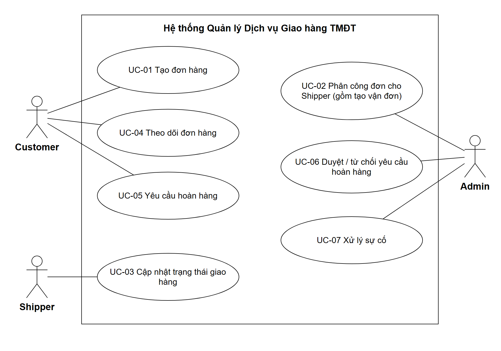
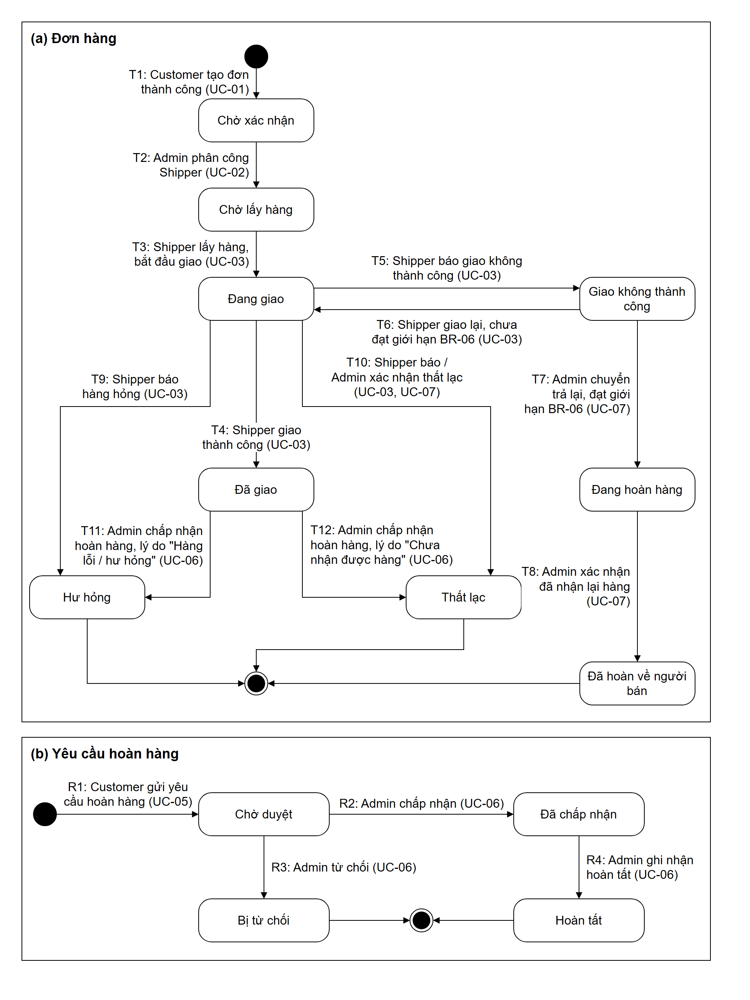

# Phụ lục A Mô hình phân tích

## A.1 Sơ đồ Use Case

Hình A.1 là sơ đồ Use Case của hệ thống, gồm ba tác nhân Customer, Admin, Shipper và bảy Use Case từ UC-01 đến UC-07. Mỗi Use Case được mô tả chi tiết ở mục 3.

## A.2 Sơ đồ trạng thái

Hình A.2 là sơ đồ trạng thái, cho thấy các trạng thái có thể có của (a) đơn hàng và (b) yêu cầu hoàn hàng, cùng các bước chuyển trạng thái được phép (xem BR-01). Đây là nơi duy nhất định nghĩa trạng thái; mọi mục khác của SRS chép đúng tên trạng thái ở đây.

Bảng dưới đây liệt kê các bước chuyển trên Hình A.2. T1–T12 là bước chuyển của đơn hàng, R1–R4 là bước chuyển của yêu cầu hoàn hàng.

| Mã | Từ trạng thái | Sang trạng thái | Ai hoặc sự kiện kích hoạt | UC |
|---|---|---|---|---|
| T1 | (bắt đầu) | "Chờ xác nhận" | Customer tạo đơn thành công | UC-01 |
| T2 | "Chờ xác nhận" | "Chờ lấy hàng" | Admin tạo vận đơn và phân công Shipper | UC-02 |
| T3 | "Chờ lấy hàng" | "Đang giao" | Shipper xác nhận đã lấy hàng, bắt đầu giao | UC-03 |
| T4 | "Đang giao" | "Đã giao" | Shipper xác nhận giao thành công | UC-03 |
| T5 | "Đang giao" | "Giao không thành công" | Shipper báo sự cố loại "Giao không thành công" | UC-03 (3.0.E2) |
| T6 | "Giao không thành công" | "Đang giao" | Shipper giao lại, khi số lần giao không thành công chưa đạt giới hạn ở BR-06 | UC-03 (3.1) |
| T7 | "Giao không thành công" | "Đang hoàn hàng" | Admin chuyển đơn sang trả lại, khi số lần giao không thành công đạt giới hạn ở BR-06 | UC-07 |
| T8 | "Đang hoàn hàng" | "Đã hoàn về người bán" | Admin (người bán) xác nhận đã nhận lại hàng | UC-07 (7.2) |
| T9 | "Đang giao" | "Hư hỏng" | Shipper báo sự cố loại "Hàng hỏng" | UC-03 (3.0.E1) |
| T10 | "Đang giao" | "Thất lạc" | Shipper báo sự cố loại "Thất lạc", hoặc Admin xác nhận thất lạc | UC-03 (3.0.E3), UC-07 (7.1) |
| T11 | "Đã giao" | "Hư hỏng" | Admin chấp nhận yêu cầu hoàn hàng có lý do "Hàng lỗi / hư hỏng" (xem BR-05) | UC-06 |
| T12 | "Đã giao" | "Thất lạc" | Admin chấp nhận yêu cầu hoàn hàng có lý do "Chưa nhận được hàng" (xem BR-05) | UC-06 |
| R1 | (bắt đầu) | "Chờ duyệt" | Customer gửi yêu cầu hoàn hàng | UC-05 |
| R2 | "Chờ duyệt" | "Đã chấp nhận" | Admin chấp nhận | UC-06 |
| R3 | "Chờ duyệt" | "Bị từ chối" | Admin từ chối | UC-06 (6.1) |
| R4 | "Đã chấp nhận" | "Hoàn tất" | Admin ghi nhận đã hoàn tất hoàn hàng (không xử lý tiền, xem BR-07) | UC-06 (6.2) |

Trạng thái kết thúc của đơn hàng là "Đã hoàn về người bán", "Hư hỏng" và "Thất lạc". "Đã giao" kết thúc luồng bình thường, nhưng đơn vẫn có thể chuyển sang "Hư hỏng" hoặc "Thất lạc" qua T11, T12. Trạng thái kết thúc của yêu cầu hoàn hàng là "Bị từ chối" và "Hoàn tất".

Hàng hỏng và hàng thất lạc đều có hai ngả phát hiện nhưng về cùng một trạng thái: hỏng qua T9 (Shipper) hoặc T11 (người mua); thất lạc qua T10 (Shipper hoặc Admin) hoặc T12 (người mua).

Sự cố chỉ báo được khi đơn ở trạng thái "Đang giao" (T5, T9, T10). Báo sự cố ở trạng thái khác: TBD (xem C-11).
