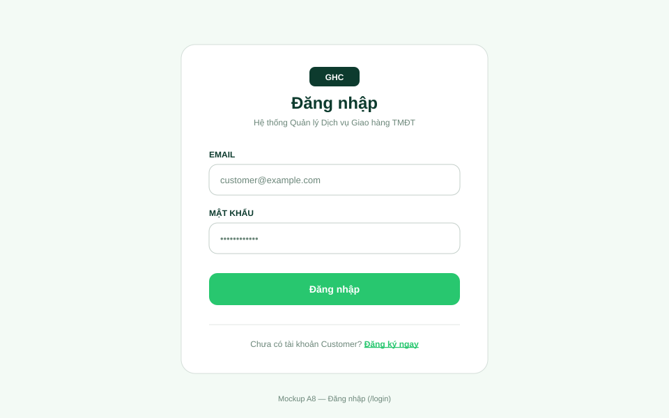
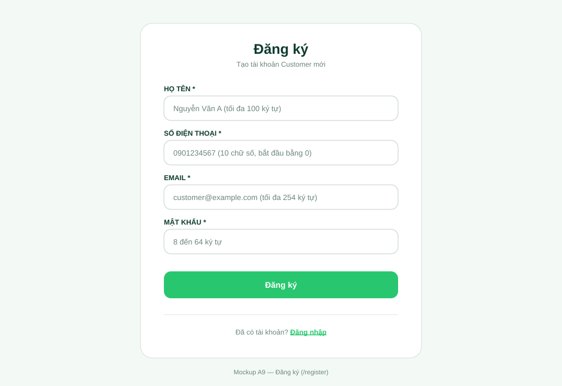
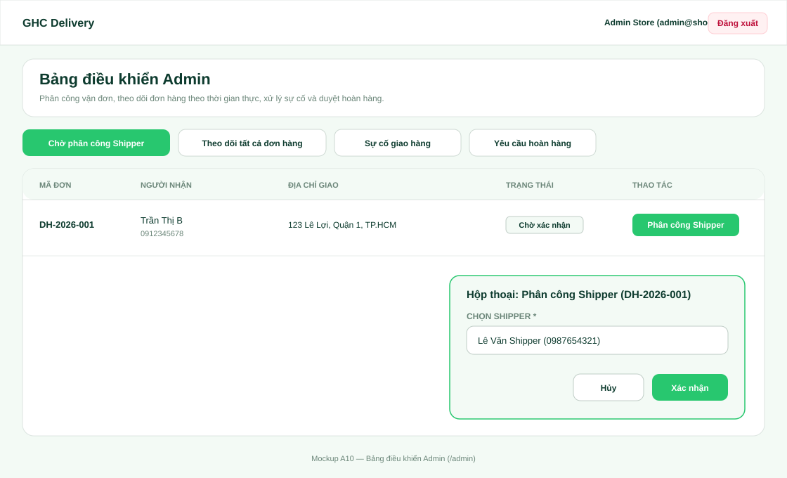
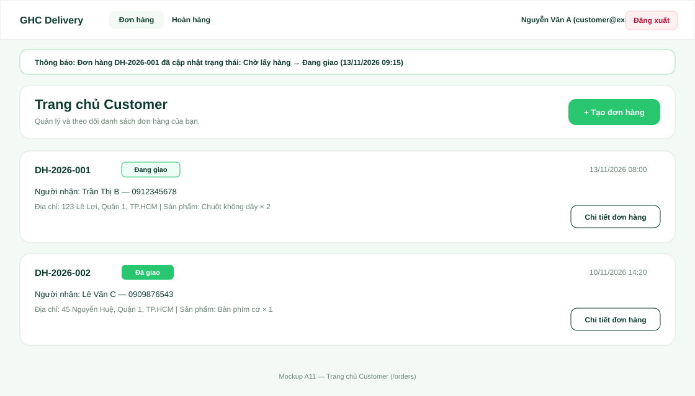
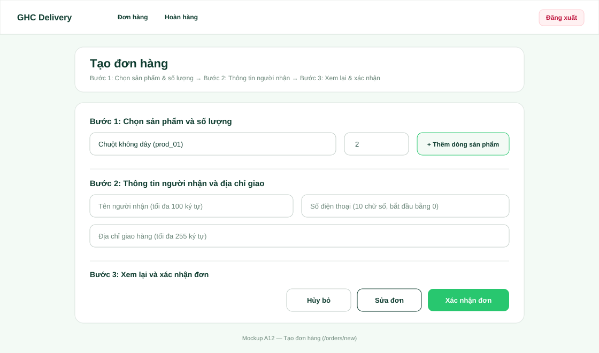
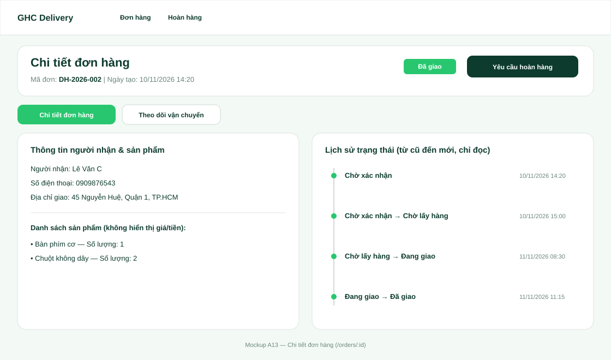
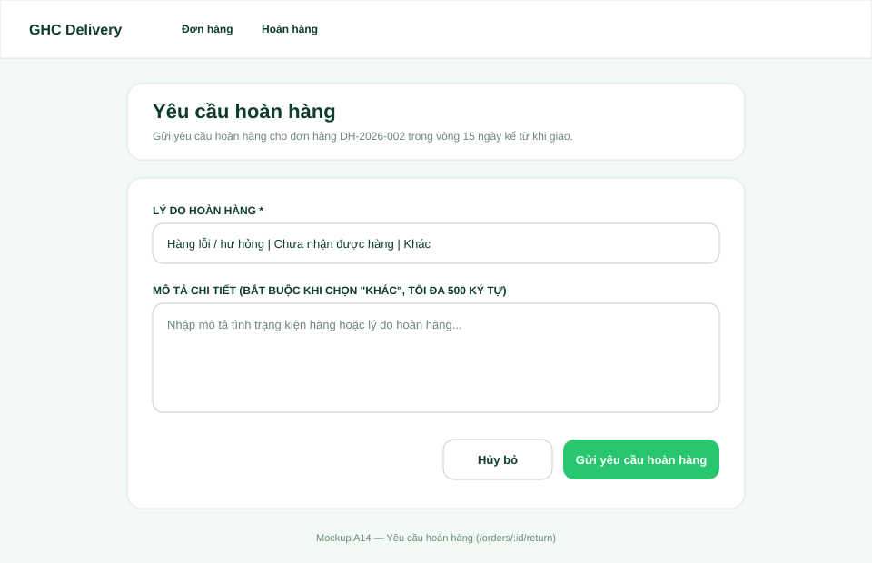
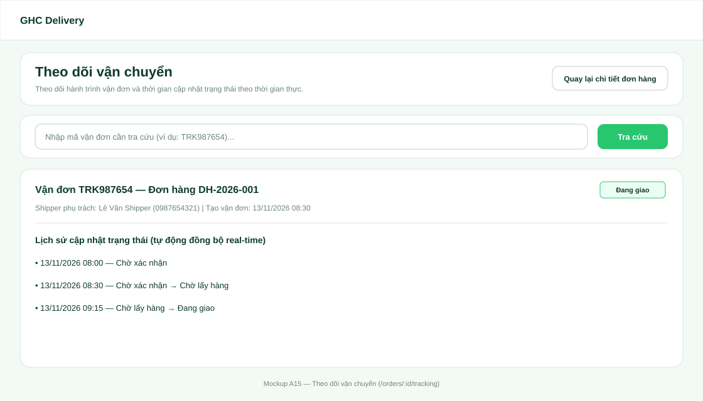
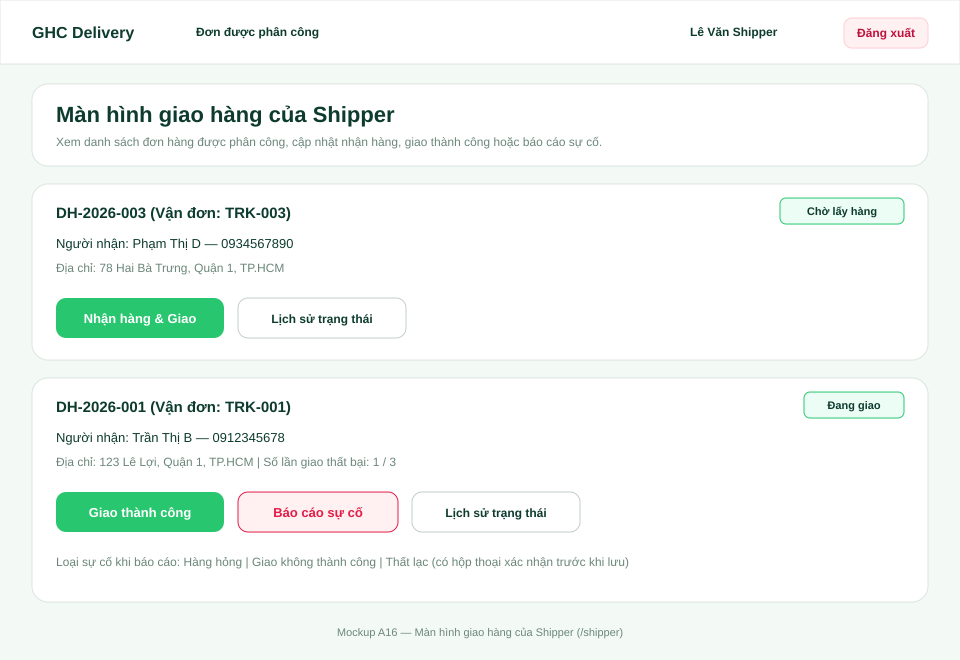

# UI Mockups (A8–A16) — E-commerce Delivery Management System

Bộ 9 mockup giao diện người dùng (thiết kế theo hệ thống thiết kế Neobank Mint trong [design-system.md](../design-system.md), khớp tên màn hình và thuật ngữ tiếng Việt trong SRS `UI-1`, `CO-2`, Phụ lục B).

## Bảng ánh xạ Backlog A8–A16 và Test Case UI-1

| Backlog | Test Case | Tên màn hình (`UI-1`) | Vai trò | Đường dẫn | Tệp Mockup |
|---|---|---|---|---|---|
| A8 | `TC-NFR-038` | Đăng nhập | Chưa đăng nhập | `/`, `/login` | [01-login-screen.svg](01-login-screen.svg) |
| A9 | `TC-NFR-039` | Đăng ký | Chưa đăng nhập | `/register` | [02-register-screen.svg](02-register-screen.svg) |
| A10 | `TC-NFR-045` | Bảng điều khiển Admin | Admin | `/admin` | [03-admin-dashboard.svg](03-admin-dashboard.svg) |
| A11 | `TC-NFR-040` | Trang chủ Customer | Customer | `/orders` | [04-customer-home.svg](04-customer-home.svg) |
| A12 | `TC-NFR-041` | Tạo đơn hàng | Customer | `/orders/new` | [05-create-order.svg](05-create-order.svg) |
| A13 | `TC-NFR-042` | Chi tiết đơn hàng | Customer / Admin / Shipper | `/orders/:id` | [06-order-detail.svg](06-order-detail.svg) |
| A14 | `TC-NFR-043` | Yêu cầu hoàn hàng | Customer | `/orders/:id/return` | [07-return-request.svg](07-return-request.svg) |
| A15 | `TC-NFR-044` | Theo dõi vận chuyển | Customer / Admin | `/orders/:id/tracking` | [08-shipment-tracking.svg](08-shipment-tracking.svg) |
| A16 | `TC-NFR-046` | Màn hình giao hàng của Shipper | Shipper | `/shipper` | [09-shipper-delivery.svg](09-shipper-delivery.svg) |

## Quy ước chung trên toàn bộ 9 màn hình

- **Bảng màu (Neobank Mint)**: Nền `#F3FAF5`, thẻ `#FFFFFF`, chữ chính `#0D3B2E`, chữ phụ `#6B8679`, nút chính `#28C76F`, cảnh báo `#D97706`, lỗi/nguy hiểm `#E11D48`.
- **Phạm vi v1.0**: Không có trường tiền/giá/phí/hoàn tiền/bồi thường (`BR-07`), không có chức năng tìm kiếm/lọc/sửa/hủy đơn đã lưu, không có nút sửa/xóa lịch sử trạng thái (`DI-1`).
- **Thông báo & Real-time**: Khi đã đăng nhập, thanh đầu trang hiển thị thông tin tài khoản và nút Đăng xuất; banner mất kết nối hiển thị khi ngoại tuyến; màn hình Customer hiển thị thanh thông báo trong ứng dụng khi trạng thái đơn thay đổi (`CI-1`).

## Chi tiết từng màn hình

### A8 — Đăng nhập (`01-login-screen.svg`)

- **Trường nhập**: Email, Mật khẩu.
- **Hành động**: Nút `Đăng nhập`; liên kết điều hướng `Đăng ký tài khoản Customer` sang màn hình Đăng ký (`/register`).

### A9 — Đăng ký (`02-register-screen.svg`)

- **Trường nhập**: Họ tên (tối đa 100 ký tự), Số điện thoại (10 chữ số bắt đầu bằng `0`), Email (tối đa 254 ký tự), Mật khẩu (8–64 ký tự).
- **Hành động**: Nút `Đăng ký`; liên kết quay lại `Đăng nhập` (`/login`).

### A10 — Bảng điều khiển Admin (`03-admin-dashboard.svg`)

- **4 tab nghiệp vụ**: Chờ phân công Shipper (`Chờ xác nhận`), Theo dõi tất cả đơn hàng (mọi trạng thái, cập nhật real-time), Sự cố giao hàng (chưa giải quyết, chuyển `Đang hoàn hàng` khi đủ 3 lần giao không thành công, ghi kết quả xử lý), Yêu cầu hoàn hàng (`Chờ duyệt` / `Đã chấp nhận`, chấp nhận / từ chối kèm lý do / hoàn tất).
- **Hộp thoại**: Chọn Shipper để tạo vận đơn và phân công (`Chờ xác nhận` → `Chờ lấy hàng`).

### A11 — Trang chủ Customer (`04-customer-home.svg`)

- **Điều hướng**: Thanh đầu trang (`Đơn hàng`, `Hoàn hàng`, thông tin tài khoản, `Đăng xuất`); nút chính `Tạo đơn hàng` (`/orders/new`).
- **Nội dung**: Danh sách đơn hàng của chính Customer (mã đơn, thời điểm tạo `dd/MM/yyyy HH:mm`, trạng thái hiện tại, sản phẩm, người nhận, liên kết xem Chi tiết đơn hàng).

### A12 — Tạo đơn hàng (`05-create-order.svg`)

- **3 bước**: (1) Chọn sản phẩm & số lượng (hỗ trợ thêm nhiều dòng, không trùng sản phẩm, số lượng nguyên ≥ 1); (2) Thông tin người nhận (họ tên, số điện thoại 10 số bắt đầu bằng `0`, địa chỉ giao); (3) Xem lại & xác nhận (`Xác nhận đơn`, `Sửa đơn`, `Hủy bỏ`).

### A13 — Chi tiết đơn hàng (`06-order-detail.svg`)

- **Nội dung**: Mã đơn, huy hiệu trạng thái hiện tại, 2 tab (`Chi tiết đơn hàng` và `Theo dõi vận chuyển`), danh sách sản phẩm & người nhận, lịch sử trạng thái từ cũ đến mới (`dd/MM/yyyy HH:mm`, chỉ đọc).
- **Hành động theo vai trò**: Customer có nút `Yêu cầu hoàn hàng` (khi đơn `Đã giao`); Admin có `Xác nhận thất lạc` (khi `Đang giao`) và `Xác nhận đã nhận lại hàng` (khi `Đang hoàn hàng`).

### A14 — Yêu cầu hoàn hàng (`07-return-request.svg`)

- **Điều kiện hiển thị form**: Đơn ở trạng thái `Đã giao`, trong thời hạn 15 ngày và chưa có yêu cầu hoàn hàng; ngược lại hiển thị thông báo từ chối.
- **Trường nhập**: Lý do hoàn hàng (`Hàng lỗi / hư hỏng`, `Chưa nhận được hàng`, `Khác`), Mô tả chi tiết (bắt buộc khi chọn `Khác`, tối đa 500 ký tự).
- **Hành động**: Nút `Gửi yêu cầu hoàn hàng`, nút `Hủy bỏ`.

### A15 — Theo dõi vận chuyển (`08-shipment-tracking.svg`)

- **Nội dung**: Ô tra cứu theo mã vận đơn, thông tin vận đơn (mã vận đơn, Shipper phụ trách, thời điểm tạo vận đơn), trạng thái hiện tại và dòng thời gian lịch sử trạng thái cập nhật real-time.
- **Điều hướng**: Liên kết `Quay lại chi tiết đơn hàng`.

### A16 — Màn hình giao hàng của Shipper (`09-shipper-delivery.svg`)

- **Nội dung**: Danh sách thẻ đơn hàng được phân công cho chính Shipper.
- **Hành động theo trạng thái (có hộp thoại xác nhận)**: `Nhận hàng & Giao` (`Chờ lấy hàng` → `Đang giao`), `Giao lại hàng` (`Giao không thành công` với < 3 lần → `Đang giao`), `Giao thành công` (`Đang giao` → `Đã giao`), `Báo cáo sự cố` (`Đang giao` → chọn `Hàng hỏng` / `Giao không thành công` / `Thất lạc` + ghi chú), `Lịch sử trạng thái`.
