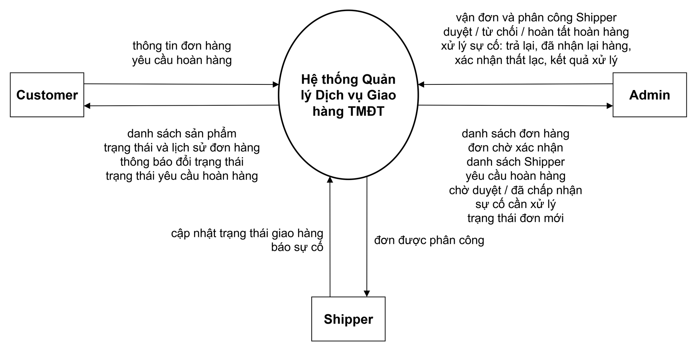
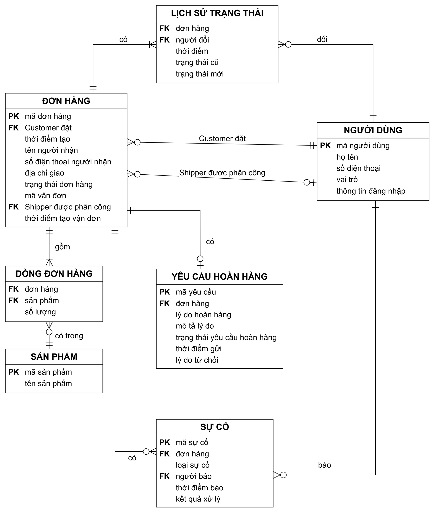
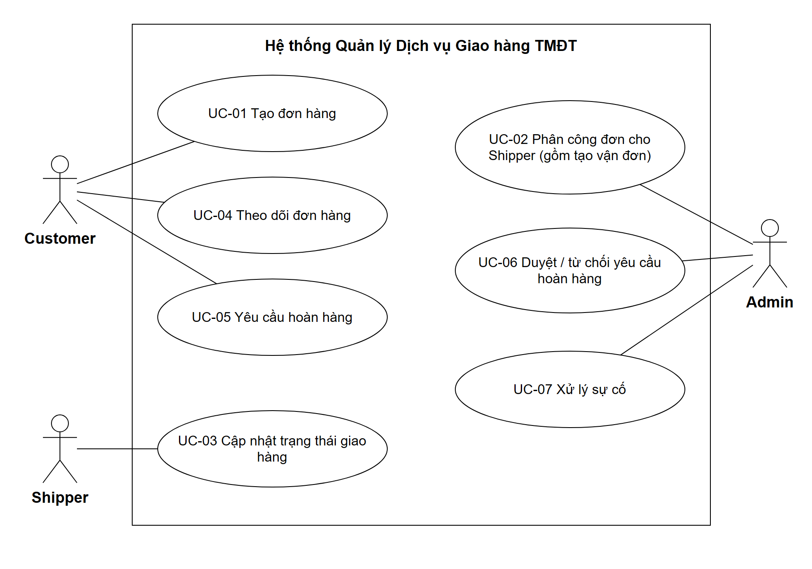
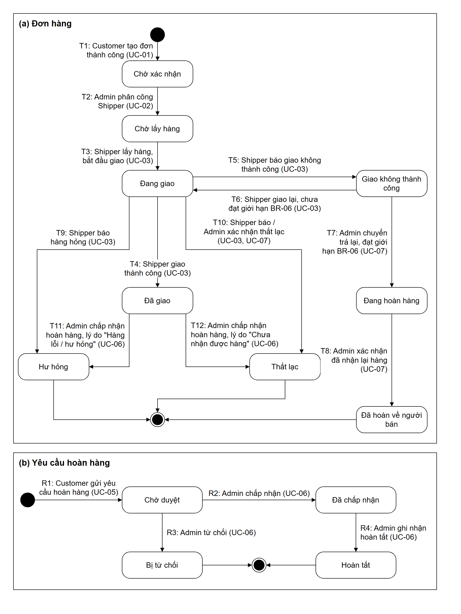

# Đặc tả yêu cầu phần mềm cho Ứng dụng Quản lý Dịch vụ Giao hàng Thương mại điện tử, phiên bản 1.0

Phiên bản 1.0 nháp 4

Soạn bởi TV1

Nhóm 10 – SE113 Kiểm chứng phần mềm

10/11/2026

## Lịch sử sửa đổi

| **Tên** | **Ngày** | **Lý do thay đổi** | **Phiên bản** |
|---|---|---|---|
| TV1 | 31/10/2026 | Bản nháp đầu tiên, gửi TV2 review | 1.0 nháp 1 |
| TV1 | 02/11/2026 | Sửa theo review: tách, thêm và đổi nội dung một số ID (xem srs_id_changes.md) | 1.0 nháp 2 |
| TV2 | 03/11/2026 | Sửa theo review: đóng C-15, thêm luồng 3.2 của UC-03, SEC-8, SEC-9; tách bước 3 của luồng 7.0; đổi Return.Review.Issue thành Return.Review.OrderStatus; SRS.md thành bản gốc | 1.0 nháp 3 |
| TV1 | 10/11/2026 | Chốt C-1 đến C-14: điền các chỗ TBD; thêm CO-2, ngoại lệ 5.0.E4 của UC-05; thêm phần tử dữ liệu email, mật khẩu, số điện thoại, mô tả lý do; thêm mục 2.6 Tài liệu người dùng, mục 3.5 Tài khoản, SEC-10, SEC-11; chốt độ dài và định dạng ngày giờ ở §4.2; thêm thuật ngữ Tài khoản, giả định AS-5; thêm tài liệu tham khảo S6–S13 | 1.0 nháp 4 |

## 1 Giới thiệu

### 1.1 Mục đích

Tài liệu này đặc tả yêu cầu phần mềm (Software Requirements Specification, SRS) cho phiên bản 1.0 của Ứng dụng Quản lý Dịch vụ Giao hàng Thương mại điện tử. Tài liệu mô tả các yêu cầu chức năng và phi chức năng của hệ thống.

Người dùng tài liệu gồm người phát triển web, người kiểm thử và giảng viên. Người phát triển web dựa vào tài liệu để xây dựng hệ thống. Người kiểm thử dựa vào tài liệu để kiểm tra hệ thống hoạt động đúng. Test Plan §2 lấy ID yêu cầu từ tài liệu này.

### 1.2 Quy ước tài liệu

| **Loại** | **Định dạng** | **Ví dụ** |
|---|---|---|
| Tính năng | FE-x (như bộ mẫu COS [3]) | FE-1 |
| Use Case | UC-xx, đánh số liên tục | UC-01 |
| Yêu cầu chức năng | Nhóm.Việc.ChiTiết (như bộ mẫu COS [3]). Nhóm: Order (3.1), Track (3.2), Return (3.3), Issue.Report (3.4.1), Issue.Resolve (3.4.2), Account (3.5) | Order.Create.Receiver |
| Ngoại lệ trong UC | x.0.Ey (như bộ mẫu COS [3]) | 3.0.E2 |
| Quy tắc nghiệp vụ | BR-xx, đánh số liên tục | BR-01 |
| Yêu cầu phi chức năng | RT-x, SEC-x, ROB-x | RT-1 |
| Giao diện | UI-x, SI-x, CI-x | CI-1 |
| Môi trường / Ràng buộc / Giả định / Phụ thuộc | OE-x, CO-x, AS-x, DE-x | AS-1 |
| Dữ liệu | DI-x | DI-1 |

Yêu cầu chức năng là các mã dạng Nhóm.Việc.ChiTiết ở mục 3. Yêu cầu phi chức năng gồm các mã OE, CO, UI, SI, CI, DI, RT, SEC, ROB. Mã AS, DE là giả định và phụ thuộc, không phải yêu cầu.

Luật viết:

- Câu yêu cầu viết "Hệ thống phải …" (dịch từ "shall"). Mỗi câu chỉ chứa 1 yêu cầu.
- Thuật ngữ dùng đúng Phụ lục B. Lần đầu xuất hiện có thể ghi kèm tiếng Anh trong ngoặc.
- Tham chiếu chứ không chép lại: "(xem BR-03)", "(xem Hình A.2)".
- Không tự đặt số liệu. Chưa có thì ghi "chưa có số liệu".

Chỗ nhóm chưa chốt ghi TBD (xem C-x); mọi vấn đề này được liệt kê ở Phụ lục C. Phiên bản này không còn chỗ TBD.

### 1.3 Phạm vi dự án và tính năng

Ứng dụng Quản lý Dịch vụ Giao hàng Thương mại điện tử là web riêng của một cửa hàng, không phải sàn có nhiều người bán. Customer (người mua) tạo đơn hàng, theo dõi tình trạng vận chuyển và yêu cầu hoàn hàng; Admin (nhân viên cửa hàng) tạo vận đơn, phân công Shipper, duyệt yêu cầu hoàn hàng và xử lý sự cố; Shipper giao hàng và cập nhật trạng thái. Trạng thái đơn hàng được cập nhật theo sự kiện (real-time) trên màn hình người dùng đang mở, không cần tải lại trang (xem RT-1).

Phiên bản 1.0 gồm 4 tính năng. Cả 4 có độ ưu tiên Cao, vì đề bài [1] bắt buộc cả 4.

**FE-1:** Tạo đơn hàng (xem 3.1).

**FE-2:** Theo dõi tình trạng vận chuyển (xem 3.2).

**FE-3:** Hoàn hàng (xem 3.3).

**FE-4:** Xử lý ngoại lệ: hỏng, trả lại, thất lạc (xem 3.4).

Ngoài phạm vi phiên bản 1.0 (mã trong ngoặc là dòng backlog, xem [2]):

- Nhiều cửa hàng (xem AS-1).
- Báo cáo thống kê (A41, A54–A57, A70).
- Quản lý tài khoản người dùng / Shipper (A33, A34).
- Sửa / hủy / tìm kiếm đơn hàng đã lưu (A35–A37).
- Thanh toán, phí, hoàn tiền, bồi thường. Hệ thống chỉ ghi nhận kết quả xử lý (xem BR-07).
- Danh mục sản phẩm, đánh giá sản phẩm, kho trung chuyển.
- Hoàn hàng hoặc báo sự cố cho từng sản phẩm trong đơn hàng. Yêu cầu hoàn hàng và sự cố áp dụng cho cả đơn hàng.
- Báo sự cố khi đơn hàng không ở trạng thái "Đang giao", ví dụ hàng hỏng hoặc thất lạc lúc đơn ở "Đang hoàn hàng" (xem Hình A.2).

Đăng ký, đăng nhập, đăng xuất không thuộc 4 tính năng của đề bài. Yêu cầu của chúng nằm ở mục 3.5 (Tài khoản), SEC-1, SEC-9 đến SEC-11 và PRE-1 của các Use Case.

### 1.4 Tài liệu tham khảo

1. Đề tài 20: Ứng dụng Quản lý Dịch vụ Giao hàng Thương mại điện tử. Đề đồ án cuối kỳ, môn SE113 Kiểm chứng phần mềm, Trường Đại học Công nghệ Thông tin.
2. Nhóm 10. Backlog dự án (BackLogPlan.xlsx), Bài tập 1, môn SE113 Kiểm chứng phần mềm, 09/2026.
3. Wiegers, Karl. Cafeteria Ordering System, Release 1.0: Vision and Scope Document, Use Cases, Software Requirements Specification (Version 1.0 approved) và Business Rules. Process Impact, 2013. Kèm ví dụ cùng tác giả: Software Requirements Specification for PearlsFromSand.com, Version 1.1 approved, 2013.
4. Giảng viên. Test Plan, slide bài giảng môn SE113 Kiểm chứng phần mềm, Trường Đại học Công nghệ Thông tin, cập nhật 03/2014.
5. (S1) Shopee Blog – Cách trả hàng hoàn tiền trên Shopee. https://shopee.vn/blog/cach-tra-hang-hoan-tien-tren-shopee/
6. (S2) Shopee Blog – Kiểm tra đơn hàng Shopee. https://shopee.vn/blog/kiem-tra-don-hang-shopee/
7. (S3) Công ty TNHH Shopee Express – Điều khoản sử dụng SPX Express. https://spx.vn/T&C.pdf
8. (S4) VnExpress 13/3/2024 – Shopee cập nhật chính sách đổi trả hàng. https://vnexpress.net/shopee-cap-nhat-chinh-sach-doi-tra-hang-4721617.html
9. (S5) BigSeller 16/07/2026 – SPX Express là gì? Tra cứu đơn hàng. https://www.bigseller.com/blog/articleDetails/spx-express-la-gi-tra-cuu-don-hang.4760.htm
10. (S6) GHN – Chính sách bồi thường của GHN (Mới), áp dụng cho đơn hàng tạo từ 20/05/2026. https://ghn.vn/pages/chinh-sach-boi-thuong-cua-ghn-moi
11. (S7) GHTK Blog 13/10/2025 – Đơn hàng giao lại tối đa mấy lần? Chi tiết chính sách giao lại tại GHTK. https://ghtk.vn/blog/giao-lai/
12. (S8) LuatVietnam 04/06/2018 – Đã cập nhật Quyết định chuyển thuê bao 11 số sang 10 số (Quyết định 798/QĐ-BTTTT). https://luatvietnam.vn/tin-van-ban-moi/da-cap-nhat-quyet-dinh-chuyen-thue-bao-11-so-sang-10-so-186-16629-article.html
13. (S9) WHATWG – HTML Living Standard, mục 4.10.5 The input element (định nghĩa valid e-mail address). https://html.spec.whatwg.org/multipage/input.html
14. (S10) OWASP Cheat Sheet Series – Authentication Cheat Sheet. https://cheatsheetseries.owasp.org/cheatsheets/Authentication_Cheat_Sheet.html
15. (S11) OWASP Cheat Sheet Series – Password Storage Cheat Sheet. https://cheatsheetseries.owasp.org/cheatsheets/Password_Storage_Cheat_Sheet.html
16. (S12) IETF – RFC 5321 Simple Mail Transfer Protocol, mục 4.5.3.1.3 (độ dài đường dẫn 256 octet), và errata 1690 của RFC 3696 (địa chỉ email tối đa 254 ký tự). https://www.rfc-editor.org/rfc/rfc5321 ; https://www.rfc-editor.org/errata/eid1690
17. (S13) Quốc hội – Luật Bảo vệ dữ liệu cá nhân số 91/2025/QH15, hiệu lực từ 01/01/2026. https://chinhphu.vn/?pageid=27160&docid=214590&classid=1&typegroupid=3

Các nguồn S1–S13 chỉ dùng để tham khảo nghiệp vụ và kỹ thuật. Mọi con số trong tài liệu là quyết định của nhóm; nguồn tham khảo của con số ghi ở cột Nguồn của quy tắc nghiệp vụ (xem mục 7) hoặc ở từ điển dữ liệu (xem mục 4.2).

## 2 Mô tả tổng quan

### 2.1 Bối cảnh sản phẩm

Ứng dụng Quản lý Dịch vụ Giao hàng Thương mại điện tử là một hệ thống phần mềm mới. Hệ thống là web riêng của một cửa hàng, không phải sàn có nhiều người bán (xem AS-1). Ba lớp người dùng làm việc với hệ thống: Customer, Admin và Shipper (xem 2.2). Sơ đồ ngữ cảnh ở Hình 1 thể hiện các lớp người dùng và dữ liệu trao đổi giữa từng lớp với hệ thống. Phiên bản này không kết nối với hệ thống bên ngoài nào (xem 5.2).

*Hình 1. Sơ đồ ngữ cảnh của hệ thống*

### 2.2 Các lớp người dùng

| **Lớp người dùng** | **Mô tả** |
|---|---|
| Customer | Customer là người mua của cửa hàng, tương tự người mua trên Shopee. Customer tạo đơn hàng, theo dõi đơn hàng và yêu cầu hoàn hàng. Customer tự đăng ký tài khoản (xem AS-2). Số lượng: chưa có số liệu (xem AS-1). |
| Admin | Admin là nhân viên cửa hàng, gộp vai trò của người bán và sàn trên Shopee. Admin tạo vận đơn và phân công Shipper; duyệt hoặc từ chối yêu cầu hoàn hàng; xử lý sự cố. Có thể có nhiều tài khoản Admin, tất cả thuộc cùng một cửa hàng. Tài khoản Admin đã có sẵn (xem AS-2). Số lượng: chưa có số liệu. |
| Shipper | Shipper là nhân viên giao hàng, tương tự nhân viên SPX Express. Shipper lấy hàng, giao hàng, cập nhật trạng thái và báo sự cố. Tài khoản Shipper đã có sẵn (xem AS-2). Số lượng: chưa có số liệu (xem AS-1). |

### 2.3 Môi trường hoạt động

**OE-1:** Hệ thống phải là một ứng dụng web mà người dùng truy cập qua trình duyệt.

**OE-2:** Hệ thống phải hoạt động đúng trên Google Chrome dành cho máy tính, bản ổn định mới nhất tại thời điểm kiểm thử.

### 2.4 Ràng buộc thiết kế và cài đặt

**CO-1:** Hệ thống phải cập nhật trạng thái theo sự kiện, không dùng cơ chế tự tải lại theo chu kỳ (xem RT-1, RT-2).

**CO-2:** Hệ thống phải hiển thị giao diện bằng tiếng Việt, dùng đúng tên trạng thái, lý do hoàn hàng, loại sự cố và tên màn hình trong tài liệu này (xem Hình A.2, BR-04, Issue.Report.Type, UI-1).

### 2.5 Giả định và phụ thuộc

**AS-1:** Hệ thống phục vụ một cửa hàng; mọi sản phẩm và đơn hàng thuộc cửa hàng đó. Customer và Shipper không giới hạn số lượng. Admin có thể có nhiều tài khoản, tất cả là nhân viên của cùng cửa hàng.

**AS-2:** Tài khoản Admin và Shipper đã có sẵn; Customer tự đăng ký tài khoản.

**AS-3:** Danh sách sản phẩm có sẵn dưới dạng dữ liệu mẫu.

**AS-4:** Thanh toán nằm ngoài hệ thống (xem BR-07).

**AS-5:** Cửa hàng chịu trách nhiệm đặt thời hạn lưu và việc xóa dữ liệu cá nhân của người dùng (họ tên, email, số điện thoại, địa chỉ giao) theo Luật Bảo vệ dữ liệu cá nhân số 91/2025/QH15 (xem S13 ở mục 1.4). Phiên bản 1.0 không có chức năng xóa dữ liệu cá nhân.

Phiên bản này không có phụ thuộc bên ngoài (xem 5.2).

### 2.6 Tài liệu người dùng

Phiên bản 1.0 kèm hướng dẫn sử dụng cho các Use Case ở mục 3; hướng dẫn được viết ở giai đoạn 2 (dòng A85 của backlog [2]).

## 3 Tính năng hệ thống

### 3.1 Tạo đơn hàng

#### 3.1.1 Mô tả và độ ưu tiên

Customer đã đăng nhập chọn sản phẩm từ danh sách sản phẩm của cửa hàng, nhập số lượng, thông tin người nhận và địa chỉ giao để tạo đơn hàng. Đơn tạo thành công được gán mã đơn hàng và ở trạng thái "Chờ xác nhận" (xem Hình A.2). Customer có thể sửa hoặc hủy thao tác tạo đơn trước khi xác nhận. Sửa, hủy đơn đã tạo và thanh toán nằm ngoài phạm vi phiên bản này (xem 1.3). Độ ưu tiên = Cao.

#### 3.1.2 Use Case

| **Mã và tên:** | UC-01 Tạo đơn hàng |  |  |
|---|---|---|---|
| **Người tạo:** | TV1 | **Ngày tạo:** | 31/10/2026 |
| **Tác nhân chính:** | Customer | **Tác nhân phụ:** | Không có |
| **Mô tả:** | Customer chọn sản phẩm của cửa hàng, nhập số lượng, thông tin người nhận và địa chỉ giao, xem lại thông tin rồi xác nhận để tạo đơn hàng. Đơn tạo thành công có mã đơn hàng và ở trạng thái "Chờ xác nhận" (xem Hình A.2), chờ Admin phân công cho Shipper (xem UC-02). |  |  |
| **Điều kiện kích hoạt:** | Customer cho biết muốn tạo đơn hàng. |  |  |
| **Tiền điều kiện:** | PRE-1. Người dùng đã đăng nhập với vai trò Customer. |  |  |
| **Hậu điều kiện:** | POST-1. Đơn hàng được lưu với mã đơn hàng duy nhất và trạng thái "Chờ xác nhận" (xem Hình A.2). POST-2. Lịch sử trạng thái của đơn có bản ghi đầu tiên (xem Track.Update.History). |  |  |
| **Luồng chính:** | **1.0 Tạo đơn hàng** 1. Customer yêu cầu tạo đơn hàng. 2. Hệ thống hiển thị danh sách sản phẩm của cửa hàng. 3. Customer chọn sản phẩm và nhập số lượng cho mỗi sản phẩm đã chọn. 4. Customer nhập thông tin người nhận và địa chỉ giao. 5. Customer cho biết đã nhập xong. 6. Hệ thống kiểm tra các trường bắt buộc và định dạng từng trường (xem 1.0.E1). 7. Hệ thống hiển thị lại sản phẩm, số lượng, người nhận và địa chỉ giao. 8. Customer xác nhận đơn (tiếp tục luồng chính), yêu cầu sửa đơn (xem 1.1), hoặc hủy thao tác tạo đơn (hệ thống kết thúc UC, đơn không được lưu). 9. Hệ thống gán mã đơn hàng duy nhất, lưu đơn với trạng thái "Chờ xác nhận" (xem Hình A.2) và ghi bản ghi đầu tiên vào lịch sử trạng thái (xem 1.0.E2). 10. Hệ thống hiển thị thông báo tạo đơn thành công kèm mã đơn hàng. |  |  |
| **Luồng thay thế:** | **1.1 Sửa đơn trước khi xác nhận** 1. Ở bước 8 của luồng chính, Customer yêu cầu sửa đơn. 2. Hệ thống hiển thị thông tin đơn đã nhập để Customer sửa. 3. Customer sửa sản phẩm, số lượng, thông tin người nhận hoặc địa chỉ giao. 4. Quay lại bước 5 của luồng chính. |  |  |
| **Ngoại lệ:** | **1.0.E1 Thiếu trường bắt buộc hoặc sai định dạng** 1. Hệ thống chỉ ra trường bắt buộc còn thiếu hoặc trường sai định dạng, kể cả số lượng sai ràng buộc (xem Order.Create.Quantity). Danh sách trường bắt buộc và quy tắc định dạng: xem Order.Create.Required, Order.Create.Format. 2a. Nếu Customer bổ sung hoặc sửa các trường đó, thì quay lại bước 6 của luồng chính. 2b. Ngược lại, nếu Customer hủy thao tác tạo đơn, thì hệ thống kết thúc UC. **1.0.E2 Lưu đơn thất bại** 1. Hệ thống hoàn tác (rollback) mọi bước đã làm khi lưu đơn (xem Order.Done.Failure). 2. Hệ thống báo Customer tạo đơn không thành công kèm lý do (xem Order.Done.Reason). 3. Hệ thống kết thúc UC; đơn không được lưu. |  |  |
| **Độ ưu tiên:** | Cao |  |  |
| **Tần suất sử dụng:** | Chưa có số liệu |  |  |
| **Quy tắc nghiệp vụ:** | Không có |  |  |
| **Thông tin khác:** | Customer có thể hủy thao tác tạo đơn trước khi xác nhận đơn (xem Order.Confirm.Prompt). Một đơn có một hoặc nhiều sản phẩm, mỗi sản phẩm một dòng (xem Order.Create.Product). Yêu cầu hoàn hàng và sự cố áp dụng cho cả đơn, không cho từng sản phẩm (xem 1.3). |  |  |
| **Giả định:** | Danh sách sản phẩm có sẵn dưới dạng dữ liệu mẫu (xem AS-3). |  |  |

#### 3.1.3 Yêu cầu chức năng

**Order.Create: Customer tạo đơn hàng**
- **.Product:** Hệ thống phải cho Customer chọn một hoặc nhiều sản phẩm từ danh sách sản phẩm của cửa hàng (xem AS-3), mỗi sản phẩm một dòng và không có hai dòng cùng một sản phẩm.
- **.Quantity:** Hệ thống phải cho Customer nhập số lượng cho mỗi sản phẩm đã chọn, là số nguyên lớn hơn hoặc bằng 1.
- **.Receiver:** Hệ thống phải cho Customer nhập tên người nhận.
- **.Phone:** Hệ thống phải cho Customer nhập số điện thoại người nhận, gồm đúng 10 chữ số và bắt đầu bằng chữ số 0.
- **.Address:** Hệ thống phải cho Customer nhập địa chỉ giao dưới dạng một chuỗi văn bản tự do.
- **.Required:** Hệ thống phải kiểm tra Customer đã nhập đủ các trường bắt buộc (ít nhất một dòng sản phẩm, số lượng của mỗi dòng, tên người nhận, số điện thoại người nhận, địa chỉ giao) và chỉ ra trường còn thiếu; trường chỉ gồm khoảng trắng được coi là còn thiếu.
- **.Format:** Hệ thống phải kiểm tra định dạng của số lượng và số điện thoại người nhận theo Order.Create.Quantity, Order.Create.Phone và chỉ ra trường sai định dạng.

**Order.Confirm: Xác nhận đơn**
- **.Display:** Hệ thống phải hiển thị lại sản phẩm, số lượng, người nhận và địa chỉ giao trước khi lưu đơn.
- **.Prompt:** Hệ thống phải yêu cầu Customer chọn xác nhận đơn, sửa đơn (xem luồng 1.1 của UC-01) hoặc hủy thao tác tạo đơn.

**Order.Done: Khi Customer xác nhận đơn, hệ thống phải làm các bước sau như 1 giao dịch.**
- **.Store:** Hệ thống phải gán mã đơn hàng duy nhất và lưu đơn với trạng thái "Chờ xác nhận" (xem Hình A.2).
- **.History:** Hệ thống phải ghi bản ghi đầu tiên vào lịch sử trạng thái của đơn (xem Track.Update.History).
- **.Success:** Hệ thống phải hiển thị thông báo tạo đơn thành công kèm mã đơn hàng.
- **.Failure:** Hệ thống phải hoàn tác (rollback) giao dịch nếu một bước bất kỳ của Order.Done lỗi.
- **.Reason:** Hệ thống phải báo Customer tạo đơn không thành công kèm lý do khi Order.Done.Failure xảy ra.

### 3.2 Theo dõi tình trạng vận chuyển

#### 3.2.1 Mô tả và độ ưu tiên

Admin tạo vận đơn và phân công đơn ở trạng thái "Chờ xác nhận" cho một Shipper. Shipper cập nhật trạng thái đơn khi lấy hàng và giao hàng, và báo sự cố khi hàng bị hỏng, giao không thành công hoặc hàng thất lạc (xem 3.4.1). Mọi lần đổi trạng thái đều theo Hình A.2 (xem BR-01) và được ghi vào lịch sử trạng thái. Customer theo dõi trạng thái hiện tại và lịch sử trạng thái của đơn của mình; trạng thái mới hiển thị mà không cần tải lại trang (xem RT-1). Độ ưu tiên = Cao.

#### 3.2.2 Use Case

| **Mã và tên:** | UC-02 Phân công đơn cho Shipper (gồm tạo vận đơn) |  |  |
|---|---|---|---|
| **Người tạo:** | TV1 | **Ngày tạo:** | 31/10/2026 |
| **Tác nhân chính:** | Admin | **Tác nhân phụ:** | Không có |
| **Mô tả:** | Admin tạo vận đơn cho một đơn ở trạng thái "Chờ xác nhận" và phân công đơn cho một Shipper. Đơn chuyển sang trạng thái "Chờ lấy hàng" (xem Hình A.2). |  |  |
| **Điều kiện kích hoạt:** | Admin cho biết muốn phân công một đơn cho Shipper. |  |  |
| **Tiền điều kiện:** | PRE-1. Người dùng đã đăng nhập với vai trò Admin. |  |  |
| **Hậu điều kiện:** | POST-1. Đơn có vận đơn với mã vận đơn duy nhất và Shipper được phân công. POST-2. Đơn ở trạng thái "Chờ lấy hàng" (xem Hình A.2). |  |  |
| **Luồng chính:** | **2.0 Phân công đơn cho Shipper** 1. Admin mở danh sách đơn hàng. 2. Hệ thống hiển thị danh sách đơn ở trạng thái "Chờ xác nhận". 3. Admin chọn một đơn. 4. Admin chọn một Shipper để phân công cho đơn. 5. Admin lưu phân công (xem 2.0.E1). 6. Hệ thống tạo vận đơn có mã vận đơn duy nhất cho đơn, gồm Shipper đã chọn. 7. Hệ thống chuyển đơn sang trạng thái "Chờ lấy hàng" (xem Hình A.2) và ghi lịch sử trạng thái. |  |  |
| **Luồng thay thế:** | Không có |  |  |
| **Ngoại lệ:** | **2.0.E1 Đơn không còn ở trạng thái "Chờ xác nhận" (xem BR-01, Track.Update.Valid)** |  |  |
| **Độ ưu tiên:** | Cao |  |  |
| **Quy tắc nghiệp vụ:** | BR-01 |  |  |
| **Thông tin khác:** | Chỉ Admin được tạo vận đơn và phân công đơn cho Shipper (xem SEC-5). Sau khi lưu phân công, đơn có trong danh sách đơn được phân công của Shipper đó (xem UC-03). |  |  |

| **Mã và tên:** | UC-03 Cập nhật trạng thái giao hàng |  |  |
|---|---|---|---|
| **Người tạo:** | TV1 | **Ngày tạo:** | 31/10/2026 |
| **Tác nhân chính:** | Shipper | **Tác nhân phụ:** | Không có |
| **Mô tả:** | Shipper cập nhật trạng thái của đơn được phân công cho mình khi lấy hàng và khi giao hàng. Khi hàng bị hỏng, giao không thành công hoặc hàng thất lạc, Shipper báo sự cố; hệ thống ghi sự cố, đổi trạng thái đơn và hiển thị cho Admin. Các ngoại lệ của UC này là phần báo sự cố ở 3.4.1. |  |  |
| **Điều kiện kích hoạt:** | Shipper cho biết muốn cập nhật trạng thái của một đơn được phân công cho mình. |  |  |
| **Tiền điều kiện:** | PRE-1. Người dùng đã đăng nhập với vai trò Shipper. |  |  |
| **Hậu điều kiện:** | POST-1. Đơn ở trạng thái mới theo một bước chuyển trên Hình A.2 (xem BR-01). POST-2. Lịch sử trạng thái của đơn có thêm bản ghi cho mỗi lần đổi trạng thái (xem Track.Update.History). POST-3. Nếu Shipper báo sự cố, sự cố được lưu (xem Issue.Report.Store). |  |  |
| **Luồng chính:** | **3.0 Cập nhật trạng thái giao hàng** 1. Shipper mở danh sách đơn được phân công. 2. Hệ thống hiển thị danh sách đơn được phân công cho chính Shipper đó. 3. Shipper chọn một đơn ở trạng thái "Chờ lấy hàng" (xem 3.2). 4. Hệ thống hiển thị các trạng thái kế tiếp Shipper được chọn (xem Track.Update.Next). 5. Shipper lấy hàng và chọn trạng thái "Đang giao". 6. Hệ thống yêu cầu xác nhận và Shipper xác nhận. 7. Hệ thống chuyển đơn sang trạng thái "Đang giao" (xem Hình A.2, Track.Update.Status) và ghi lịch sử trạng thái. 8. Shipper giao hàng cho người nhận (xem 3.0.E1, 3.0.E2, 3.0.E3). 9. Shipper chọn trạng thái "Đã giao". 10. Hệ thống yêu cầu xác nhận và Shipper xác nhận. 11. Hệ thống chuyển đơn sang trạng thái "Đã giao" (xem Hình A.2, Track.Update.Status) và ghi lịch sử trạng thái. |  |  |
| **Luồng thay thế:** | **3.1 Giao lại sau khi giao không thành công** 1. Shipper chọn một đơn ở trạng thái "Giao không thành công" trong danh sách đơn được phân công. 2. Hệ thống chỉ cho chọn trạng thái "Đang giao" khi số lần giao không thành công của đơn chưa đạt giới hạn ở BR-06. 3. Shipper chọn trạng thái "Đang giao". 4. Hệ thống yêu cầu xác nhận và Shipper xác nhận. 5. Hệ thống chuyển đơn từ "Giao không thành công" sang "Đang giao" (xem Hình A.2, Track.Update.Status) và ghi lịch sử trạng thái. 6. Quay lại bước 8 của luồng chính. **3.2 Tiếp tục giao đơn đang giao** 1. Thay vì bước 3 của luồng chính, Shipper chọn một đơn ở trạng thái "Đang giao" trong danh sách đơn được phân công. 2. Quay lại bước 8 của luồng chính. |  |  |
| **Ngoại lệ:** | **3.0.E1 Hàng bị hỏng khi giao** 1. Shipper phát hiện hàng bị hư hỏng khi đơn đang ở trạng thái "Đang giao". 2. Shipper chọn báo sự cố, loại "Hàng hỏng" (xem Issue.Report.Type). 3. Hệ thống yêu cầu xác nhận và Shipper xác nhận. 4. Hệ thống lưu sự cố (xem Issue.Report.Store). 5. Hệ thống chuyển đơn sang trạng thái "Hư hỏng" (xem Hình A.2), ghi lịch sử trạng thái và hiển thị trạng thái mới cho Admin (xem RT-2). 6. Hệ thống kết thúc UC. Admin xử lý sự cố ở UC-07. **3.0.E2 Giao không thành công** 1. Shipper không giao được hàng cho người nhận khi đơn đang ở trạng thái "Đang giao". 2. Shipper chọn báo sự cố, loại "Giao không thành công" (xem Issue.Report.Type). 3. Hệ thống yêu cầu xác nhận và Shipper xác nhận. 4. Hệ thống lưu sự cố (xem Issue.Report.Store). 5. Hệ thống chuyển đơn sang trạng thái "Giao không thành công" (xem Hình A.2), ghi lịch sử trạng thái và hiển thị trạng thái mới cho Admin (xem RT-2). 6. Hệ thống tính số lần giao không thành công của đơn (xem BR-06). 7a. Nếu số lần này chưa đạt giới hạn ở BR-06, thì Shipper giao lại theo luồng 3.1. 7b. Ngược lại, nếu số lần này đạt giới hạn ở BR-06, thì Shipper không được giao lại; Admin chuyển đơn sang trạng thái "Đang hoàn hàng" rồi "Đã hoàn về người bán" ở UC-07 (xem Hình A.2), và hệ thống kết thúc UC. **3.0.E3 Hàng thất lạc** 1. Shipper không tìm thấy hàng khi đơn đang ở trạng thái "Đang giao". 2. Shipper chọn báo sự cố, loại "Thất lạc" (xem Issue.Report.Type). 3. Hệ thống yêu cầu xác nhận và Shipper xác nhận. 4. Hệ thống lưu sự cố (xem Issue.Report.Store). 5. Hệ thống chuyển đơn sang trạng thái "Thất lạc" (xem Hình A.2), ghi lịch sử trạng thái và hiển thị trạng thái mới cho Admin (xem RT-2). 6. Hệ thống kết thúc UC. Admin cũng có thể xác nhận thất lạc ở UC-07 (luồng 7.1). |  |  |
| **Độ ưu tiên:** | Cao |  |  |
| **Tần suất sử dụng:** | Chưa có số liệu |  |  |
| **Quy tắc nghiệp vụ:** | BR-01, BR-06 |  |  |
| **Thông tin khác:** | Shipper chỉ xem và cập nhật được đơn được phân công cho chính mình (xem SEC-4, SEC-8). Hệ thống từ chối mọi bước chuyển không có trên Hình A.2 và báo lý do (xem Track.Update.Valid). Các bước chuyển T5, T9, T10 chỉ thực hiện qua báo sự cố (xem Issue.Report), không chọn qua Track.Update.Next. Mỗi lần trạng thái đơn thay đổi, màn hình đang mở của Customer và Admin hiển thị trạng thái mới mà không cần tải lại trang (xem RT-1, RT-2); Customer được thông báo trong ứng dụng (xem CI-1). Sự cố chỉ báo được khi đơn ở trạng thái "Đang giao"; báo sự cố ở trạng thái khác nằm ngoài phạm vi phiên bản này (xem 1.3). Hàng hỏng hoặc thất lạc do Customer báo sau khi đơn "Đã giao" được xử lý qua yêu cầu hoàn hàng (xem UC-05, UC-06). |  |  |
| **Giả định:** | Tài khoản Shipper đã có sẵn (xem AS-2). |  |  |

| **Mã và tên:** | UC-04 Theo dõi đơn hàng |  |  |
|---|---|---|---|
| **Người tạo:** | TV1 | **Ngày tạo:** | 31/10/2026 |
| **Tác nhân chính:** | Customer | **Tác nhân phụ:** | Không có |
| **Mô tả:** | Customer xem danh sách đơn hàng của mình, rồi xem trạng thái hiện tại và lịch sử trạng thái của một đơn. |  |  |
| **Điều kiện kích hoạt:** | Customer cho biết muốn xem tình trạng vận chuyển của đơn hàng. |  |  |
| **Tiền điều kiện:** | PRE-1. Người dùng đã đăng nhập với vai trò Customer. |  |  |
| **Hậu điều kiện:** | POST-1. Trạng thái hiện tại và lịch sử trạng thái của đơn được chọn hiển thị cho Customer. |  |  |
| **Luồng chính:** | **4.0 Theo dõi đơn hàng** 1. Customer mở danh sách đơn hàng. 2. Hệ thống hiển thị danh sách đơn của chính Customer đó. 3. Customer chọn một đơn. 4. Hệ thống hiển thị trạng thái hiện tại của đơn và lịch sử trạng thái theo thứ tự thời gian, từ cũ đến mới (xem 4.0.E1). |  |  |
| **Luồng thay thế:** | Không có |  |  |
| **Ngoại lệ:** | **4.0.E1 Mất kết nối khi đang theo dõi (xem ROB-1)** |  |  |
| **Độ ưu tiên:** | Cao |  |  |
| **Quy tắc nghiệp vụ:** | Không có |  |  |
| **Thông tin khác:** | Khi trạng thái đơn thay đổi, màn hình theo dõi đơn đang mở hiển thị trạng thái mới mà không cần tải lại trang (xem RT-1). Customer chỉ xem được đơn do chính mình tạo (xem SEC-2). |  |  |

#### 3.2.3 Yêu cầu chức năng

**Track.Assign: Admin tạo vận đơn và phân công đơn cho Shipper (UC-02)**
- **.List:** Hệ thống phải hiển thị cho Admin danh sách đơn ở trạng thái "Chờ xác nhận".
- **.Shipment:** Hệ thống phải tạo vận đơn có mã vận đơn duy nhất cho đơn Admin chọn.
- **.Shipper:** Hệ thống phải cho Admin chọn một Shipper để phân công cho đơn.
- **.Status:** Hệ thống phải chuyển đơn sang trạng thái "Chờ lấy hàng" (xem Hình A.2) khi Admin lưu phân công.

**Track.Update: Shipper cập nhật trạng thái giao hàng (UC-03)**
- **.List:** Hệ thống phải hiển thị cho Shipper danh sách đơn được phân công cho chính Shipper đó.
- **.Next:** Hệ thống phải chỉ cho Shipper chọn trạng thái kế tiếp của đơn theo các bước chuyển T3, T4, T6 trên Hình A.2 (xem BR-01, BR-06).
- **.Confirm:** Hệ thống phải yêu cầu Shipper xác nhận trước khi lưu trạng thái mới.
- **.Status:** Hệ thống phải chuyển đơn sang trạng thái Shipper đã chọn (T3, T4, T6, xem Hình A.2) khi Shipper xác nhận.
- **.Valid:** Hệ thống phải từ chối mọi thao tác chuyển trạng thái đơn hàng không có trên Hình A.2 và báo lý do (xem BR-01).
- **.History:** Hệ thống phải lưu người đổi, thời điểm, trạng thái cũ và trạng thái mới mỗi khi trạng thái đơn thay đổi, bất kể ai thay đổi.

**Track.View: Customer theo dõi đơn hàng (UC-04)**
- **.List:** Hệ thống phải hiển thị cho Customer danh sách đơn của chính Customer đó.
- **.Current:** Hệ thống phải hiển thị trạng thái hiện tại của đơn được chọn.
- **.History:** Hệ thống phải hiển thị lịch sử trạng thái của đơn được chọn theo thứ tự thời gian, từ cũ đến mới.

**Track.Admin: Admin theo dõi đơn hàng (dùng ở UC-07 luồng 7.1, 7.2; xem RT-2)**
- **.List:** Hệ thống phải hiển thị cho Admin danh sách đơn hàng ở mọi trạng thái, kèm trạng thái hiện tại của mỗi đơn.

### 3.3 Hoàn hàng

#### 3.3.1 Mô tả và độ ưu tiên

Mục này mô tả chức năng "Hoàn hàng" theo Phụ lục B, khác với "Trả lại" ở mục 3.4.2 (xem Phụ lục B). Customer gửi yêu cầu hoàn hàng cho đơn của mình ở trạng thái "Đã giao" (xem BR-02), trong thời hạn yêu cầu hoàn hàng (xem BR-03), kèm một lý do (xem BR-04). Admin chấp nhận hoặc từ chối yêu cầu, rồi ghi nhận "Hoàn tất" cho yêu cầu đã chấp nhận (xem Hình A.2). Chấp nhận yêu cầu có lý do thuộc BR-05 là ngả thứ hai phát hiện hỏng hoặc thất lạc (xem 3.4). Hệ thống không xử lý tiền (xem BR-07). Độ ưu tiên = Cao.

#### 3.3.2 Use Case

| **Mã và tên:** | UC-05 Yêu cầu hoàn hàng |  |  |
|---|---|---|---|
| **Người tạo:** | TV1 | **Ngày tạo:** | 31/10/2026 |
| **Tác nhân chính:** | Customer | **Tác nhân phụ:** | Không có |
| **Mô tả:** | Customer chọn một đơn hàng đã giao của mình, chọn lý do hoàn hàng và gửi yêu cầu hoàn hàng. Hệ thống lưu yêu cầu với trạng thái "Chờ duyệt" để Admin duyệt (xem UC-06). Customer xem được trạng thái các yêu cầu hoàn hàng mình đã gửi. |  |  |
| **Điều kiện kích hoạt:** | Customer chọn gửi yêu cầu hoàn hàng cho một đơn hàng của mình, hoặc chọn xem các yêu cầu hoàn hàng đã gửi. |  |  |
| **Tiền điều kiện:** | PRE-1. Người dùng đã đăng nhập với vai trò Customer. |  |  |
| **Hậu điều kiện:** | POST-1. Yêu cầu hoàn hàng được lưu với trạng thái "Chờ duyệt" và thời điểm gửi (xem Hình A.2). POST-2. Trạng thái đơn hàng không đổi (xem Hình A.2). |  |  |
| **Luồng chính:** | **5.0 Gửi yêu cầu hoàn hàng** 1. Customer chọn một đơn hàng do chính mình tạo và chọn gửi yêu cầu hoàn hàng (xem SEC-3, 5.1). 2. Hệ thống kiểm tra đơn đang ở trạng thái "Đã giao" (xem 5.0.E1), còn trong thời hạn yêu cầu hoàn hàng (xem 5.0.E2) và chưa có yêu cầu hoàn hàng nào (xem 5.0.E4). 3. Hệ thống hiển thị danh sách lý do hoàn hàng (xem BR-04). 4. Customer chọn một lý do, nhập mô tả nếu chọn lý do "Khác", rồi gửi yêu cầu (xem 5.0.E3). 5. Hệ thống lưu yêu cầu hoàn hàng với trạng thái "Chờ duyệt" và thời điểm gửi (R1, xem Hình A.2). |  |  |
| **Luồng thay thế:** | **5.1 Xem trạng thái yêu cầu hoàn hàng** 1. Thay vì bước 1 của luồng chính, Customer chọn xem các yêu cầu hoàn hàng đã gửi. 2. Hệ thống hiển thị trạng thái hiện tại của các yêu cầu hoàn hàng do chính Customer gửi, kèm lý do từ chối với yêu cầu ở trạng thái "Bị từ chối" (xem SEC-2, Hình A.2). 3. Hệ thống kết thúc UC. |  |  |
| **Ngoại lệ:** | **5.0.E1 Đơn chưa ở trạng thái "Đã giao"** 1. Hệ thống báo Customer chỉ được yêu cầu hoàn hàng cho đơn ở trạng thái "Đã giao" (xem BR-02). 2a. Nếu Customer chọn đơn hàng khác, thì quay lại bước 2 của luồng chính. 2b. Ngược lại, nếu Customer hủy thao tác, thì hệ thống kết thúc UC. **5.0.E2 Quá thời hạn yêu cầu hoàn hàng** 1. Hệ thống báo Customer đơn đã quá thời hạn yêu cầu hoàn hàng (xem BR-03). 2a. Nếu Customer chọn đơn hàng khác, thì quay lại bước 2 của luồng chính. 2b. Ngược lại, nếu Customer hủy thao tác, thì hệ thống kết thúc UC. **5.0.E3 Chưa chọn lý do hoàn hàng, hoặc chọn "Khác" mà chưa nhập mô tả** 1. Hệ thống báo Customer phải chọn một lý do hoàn hàng, và phải nhập mô tả nếu chọn lý do "Khác" (xem BR-04, Return.Request.Reason). 2a. Nếu Customer chọn lý do hoặc nhập mô tả, thì quay lại bước 4 của luồng chính. 2b. Ngược lại, nếu Customer hủy thao tác, thì hệ thống kết thúc UC. **5.0.E4 Đơn đã có yêu cầu hoàn hàng** 1. Hệ thống báo Customer mỗi đơn hàng chỉ được gửi một yêu cầu hoàn hàng (xem Return.Request.Eligible). 2a. Nếu Customer chọn đơn hàng khác, thì quay lại bước 2 của luồng chính. 2b. Ngược lại, nếu Customer hủy thao tác, thì hệ thống kết thúc UC. |  |  |
| **Độ ưu tiên:** | Cao |  |  |
| **Tần suất sử dụng:** | Chưa có số liệu |  |  |
| **Quy tắc nghiệp vụ:** | BR-02, BR-03, BR-04 |  |  |
| **Thông tin khác:** | Mỗi đơn hàng chỉ được gửi tối đa một yêu cầu hoàn hàng (xem 5.0.E4). Hệ thống không xử lý tiền (xem BR-07). Khi Admin chấp nhận yêu cầu có lý do thuộc BR-05, trạng thái đơn đổi theo UC-06 (xem Hình A.2). |  |  |
| **Giả định:** | Không có |  |  |

| **Mã và tên:** | UC-06 Duyệt / từ chối yêu cầu hoàn hàng |  |  |
|---|---|---|---|
| **Người tạo:** | TV1 | **Ngày tạo:** | 31/10/2026 |
| **Tác nhân chính:** | Admin | **Tác nhân phụ:** | Không có |
| **Mô tả:** | Admin xem các yêu cầu hoàn hàng đang chờ duyệt, chấp nhận hoặc từ chối từng yêu cầu. Với yêu cầu đã chấp nhận, Admin ghi nhận "Hoàn tất" khi việc hoàn hàng xong (xem Hình A.2). Hệ thống chỉ ghi nhận, không xử lý tiền (xem BR-07). |  |  |
| **Điều kiện kích hoạt:** | Admin chọn xử lý yêu cầu hoàn hàng. |  |  |
| **Tiền điều kiện:** | PRE-1. Người dùng đã đăng nhập với vai trò Admin. |  |  |
| **Hậu điều kiện:** | POST-1. Yêu cầu hoàn hàng ở trạng thái "Đã chấp nhận", "Bị từ chối" hoặc "Hoàn tất" (xem Hình A.2). POST-2. Nếu yêu cầu được chấp nhận với lý do thuộc BR-05, đơn hàng ở trạng thái "Hư hỏng" hoặc "Thất lạc" (xem Hình A.2). |  |  |
| **Luồng chính:** | **6.0 Chấp nhận yêu cầu hoàn hàng** 1. Hệ thống hiển thị danh sách yêu cầu ở trạng thái "Chờ duyệt" và "Đã chấp nhận", kèm đơn hàng và lý do hoàn hàng (xem Return.Review.List). 2. Admin chọn một yêu cầu ở trạng thái "Chờ duyệt" và chấp nhận yêu cầu đó (xem 6.1, 6.0.E1). 3. Hệ thống chuyển yêu cầu sang "Đã chấp nhận" (R2, xem Hình A.2). 4. Nếu lý do hoàn hàng thuộc BR-05, hệ thống chuyển đơn hàng từ "Đã giao" sang "Hư hỏng" (T11) hoặc "Thất lạc" (T12) theo BR-05 (xem Hình A.2). |  |  |
| **Luồng thay thế:** | **6.1 Từ chối yêu cầu** 1. Tại bước 2 của luồng chính, Admin chọn từ chối yêu cầu và nhập lý do từ chối. 2. Hệ thống chuyển yêu cầu sang "Bị từ chối" (R3, xem Hình A.2) và lưu lý do từ chối (xem Return.Review.Reject). 3. Trạng thái đơn hàng không đổi (xem Hình A.2). **6.2 Ghi nhận hoàn tất** 1. Tại bước 2 của luồng chính, Admin chọn một yêu cầu ở trạng thái "Đã chấp nhận" và ghi nhận hoàn tất. 2. Hệ thống chuyển yêu cầu sang "Hoàn tất" (R4, xem Hình A.2), không xử lý tiền (xem BR-07). |  |  |
| **Ngoại lệ:** | **6.0.E1 Yêu cầu không còn ở trạng thái "Chờ duyệt" (xem BR-01, Return.Review.Valid)** |  |  |
| **Độ ưu tiên:** | Cao |  |  |
| **Quy tắc nghiệp vụ:** | BR-01, BR-05, BR-07 |  |  |
| **Thông tin khác:** | Chấp nhận yêu cầu có lý do thuộc BR-05 là ngả người mua phát hiện hỏng hoặc thất lạc (xem 3.4). Mỗi lần đổi trạng thái đơn được ghi vào lịch sử trạng thái (xem Track.Update.History). |  |  |

#### 3.3.3 Yêu cầu chức năng

**Return.Request: Customer gửi yêu cầu hoàn hàng (UC-05; quyền: xem SEC-3)**
- **.Eligible:** Hệ thống phải chỉ cho Customer gửi yêu cầu hoàn hàng với đơn đang ở trạng thái "Đã giao" (xem BR-02) và chưa có yêu cầu hoàn hàng nào.
- **.Window:** Hệ thống phải chỉ cho Customer gửi yêu cầu hoàn hàng khi còn trong thời hạn yêu cầu hoàn hàng (xem BR-03).
- **.Reason:** Hệ thống phải bắt buộc Customer chọn một lý do hoàn hàng từ danh sách ở BR-04, và nhập mô tả lý do khi chọn lý do "Khác", trước khi gửi yêu cầu.
- **.Store:** Hệ thống phải lưu yêu cầu hoàn hàng với trạng thái "Chờ duyệt" và thời điểm gửi (R1, xem Hình A.2).

**Return.View: Customer xem yêu cầu hoàn hàng (UC-05, luồng 5.1)**
- **.Status:** Hệ thống phải hiển thị cho Customer trạng thái hiện tại của các yêu cầu hoàn hàng do chính Customer đó gửi, kèm lý do từ chối với yêu cầu ở trạng thái "Bị từ chối".

**Return.Review: Admin duyệt / từ chối yêu cầu hoàn hàng (UC-06)**
- **.List:** Hệ thống phải hiển thị cho Admin danh sách yêu cầu hoàn hàng ở trạng thái "Chờ duyệt" và "Đã chấp nhận", kèm đơn hàng và lý do hoàn hàng của mỗi yêu cầu.
- **.Approve:** Hệ thống phải chuyển yêu cầu sang trạng thái "Đã chấp nhận" khi Admin chấp nhận yêu cầu đó (R2, xem Hình A.2).
- **.Reject:** Hệ thống phải chuyển yêu cầu sang trạng thái "Bị từ chối" khi Admin từ chối yêu cầu đó (R3, xem Hình A.2), chỉ khi Admin đã nhập lý do từ chối.
- **.OrderStatus:** Hệ thống phải chuyển đơn hàng sang trạng thái "Hư hỏng" (T11) hoặc "Thất lạc" (T12) theo BR-05 khi Admin chấp nhận yêu cầu có lý do thuộc BR-05 (xem Hình A.2).
- **.Complete:** Hệ thống phải cho Admin ghi nhận "Hoàn tất" cho yêu cầu ở trạng thái "Đã chấp nhận" (R4, xem Hình A.2) mà không xử lý tiền (xem BR-07).
- **.Valid:** Hệ thống phải từ chối mọi thao tác chuyển trạng thái yêu cầu hoàn hàng không có trên Hình A.2 và báo lý do (xem BR-01).

### 3.4 Xử lý ngoại lệ

Đề bài yêu cầu xử lý 3 ngoại lệ: hàng hỏng, trả lại và thất lạc. Mục 3.4.1 mô tả việc Shipper báo sự cố khi giao hàng; mục 3.4.2 mô tả việc Admin xử lý sự cố và trả lại hàng. Hỏng và thất lạc còn được phát hiện qua yêu cầu hoàn hàng của Customer (xem 3.3, BR-05); hai ngả dẫn về cùng trạng thái "Hư hỏng" hoặc "Thất lạc" (xem Hình A.2).

#### 3.4.1 Báo sự cố khi giao hàng

##### 3.4.1.1 Mô tả và độ ưu tiên

Shipper báo sự cố khi đơn đang ở trạng thái "Đang giao" (xem Hình A.2). Các bước báo sự cố nằm ở ngoại lệ của UC-03 (mục 3.2.2): 3.0.E1 Hàng bị hỏng khi giao, 3.0.E2 Giao không thành công, 3.0.E3 Hàng thất lạc; mục này không viết lại. Báo sự cố khi đơn ở trạng thái khác nằm ngoài phạm vi phiên bản này (xem 1.3). Độ ưu tiên = Cao.

##### 3.4.1.2 Yêu cầu chức năng

**Issue.Report: Shipper báo sự cố khi giao hàng (UC-03, xem 3.0.E1, 3.0.E2, 3.0.E3)**
- **.Type:** Hệ thống phải cho Shipper chọn một trong các loại sự cố "Hàng hỏng", "Giao không thành công", "Thất lạc" cho đơn ở trạng thái "Đang giao".
- **.Store:** Hệ thống phải lưu mỗi sự cố gồm đơn hàng, loại sự cố, người báo và thời điểm báo.
- **.Status:** Hệ thống phải chuyển đơn sang trạng thái tương ứng với loại sự cố: "Hàng hỏng" sang "Hư hỏng" (T9), "Giao không thành công" sang "Giao không thành công" (T5), "Thất lạc" sang "Thất lạc" (T10) (xem Hình A.2).

#### 3.4.2 Xử lý sự cố và trả lại hàng

##### 3.4.2.1 Mô tả và độ ưu tiên

Admin xử lý các sự cố Shipper đã báo ở mục 3.4.1, gồm cả ngoại lệ "Trả lại" (xem Phụ lục B). Đơn giao không thành công chưa đạt giới hạn ở BR-06 thì Shipper giao lại (xem luồng 3.1 của UC-03). Đạt giới hạn thì Admin chuyển đơn sang "Đang hoàn hàng", và khi đã nhận lại hàng thì xác nhận để đơn sang "Đã hoàn về người bán" (xem Hình A.2). Admin cũng xác nhận được thất lạc với đơn "Đang giao", và ghi kết quả xử lý cho từng sự cố mà không xử lý tiền (xem BR-07). Độ ưu tiên = Cao.

##### 3.4.2.2 Use Case

| **Mã và tên:** | UC-07 Xử lý sự cố |  |  |
|---|---|---|---|
| **Người tạo:** | TV1 | **Ngày tạo:** | 31/10/2026 |
| **Tác nhân chính:** | Admin | **Tác nhân phụ:** | Không có |
| **Mô tả:** | Admin xử lý các sự cố đã được ghi khi giao hàng (xem 3.0.E1, 3.0.E2, 3.0.E3 của UC-03 và luồng 7.1). Admin chuyển đơn giao không thành công sang "Đang hoàn hàng", xác nhận hàng đã hoàn về người bán, xác nhận thất lạc và ghi kết quả xử lý (xem Hình A.2). |  |  |
| **Điều kiện kích hoạt:** | Có sự cố chưa có kết quả xử lý; hoặc Admin phát hiện một đơn ở trạng thái "Đang giao" bị thất lạc; hoặc Admin đã nhận lại hàng của một đơn ở trạng thái "Đang hoàn hàng". |  |  |
| **Tiền điều kiện:** | PRE-1. Người dùng đã đăng nhập với vai trò Admin. |  |  |
| **Hậu điều kiện:** | POST-1. Sự cố có kết quả xử lý (xem BR-07). POST-2. Đơn trả lại ở trạng thái "Đang hoàn hàng" hoặc "Đã hoàn về người bán"; đơn được Admin xác nhận thất lạc ở trạng thái "Thất lạc" (xem Hình A.2). |  |  |
| **Luồng chính:** | **7.0 Xử lý sự cố** 1. Hệ thống hiển thị cho Admin danh sách sự cố chưa có kết quả xử lý (xem Issue.Resolve.List). 2. Admin chọn một sự cố. 3. Hệ thống kiểm tra loại sự cố, trạng thái đơn và số lần giao không thành công của đơn (xem BR-06). 3a. Nếu sự cố thuộc loại "Giao không thành công" (xem 3.0.E2), đơn đang ở trạng thái "Giao không thành công" và số lần giao không thành công đã đạt giới hạn ở BR-06, thì sang bước 4. 3b. Ngược lại (chưa đạt giới hạn, sự cố khác loại, hoặc đơn không còn ở "Giao không thành công"), thì sang bước 5. Admin yêu cầu chuyển trả lại khi chưa đạt giới hạn: xem 7.0.E1. 4. Khi đã đạt giới hạn, Admin phải chuyển đơn sang trả lại trước khi ghi kết quả (xem BR-06, Issue.Resolve.Result); hệ thống chuyển đơn sang "Đang hoàn hàng" (T7, xem Hình A.2). 5. Admin ghi kết quả xử lý của sự cố (bắt buộc, xem Issue.Resolve.Result); hệ thống lưu kết quả, chỉ ghi nhận, không xử lý tiền (xem BR-07). Sự cố không còn trong danh sách ở bước 1. |  |  |
| **Luồng thay thế:** | **7.1 Admin xác nhận thất lạc** 1. Thay vì bước 2 của luồng chính, Admin chọn một đơn ở trạng thái "Đang giao" trong danh sách đơn hàng (xem Track.Admin.List) và xác nhận thất lạc. 2. Hệ thống ghi sự cố loại "Thất lạc" với người báo là Admin. 3. Hệ thống chuyển đơn sang "Thất lạc" (T10, xem Hình A.2). 4. Quay lại bước 1 của luồng chính. **7.2 Admin xác nhận đã nhận lại hàng** 1. Thay vì bước 1 của luồng chính, Admin chọn một đơn ở trạng thái "Đang hoàn hàng" trong danh sách đơn hàng (xem Track.Admin.List). 2. Khi đã nhận lại hàng, Admin xác nhận. 3. Hệ thống chuyển đơn sang "Đã hoàn về người bán" (T8, xem Hình A.2). 4. Hệ thống kết thúc UC. |  |  |
| **Ngoại lệ:** | **7.0.E1 Admin yêu cầu chuyển trả lại khi chưa đạt số lần giao không thành công ở BR-06 (xem Issue.Resolve.Return, Track.Update.Valid)** |  |  |
| **Độ ưu tiên:** | Cao |  |  |
| **Quy tắc nghiệp vụ:** | BR-01, BR-06, BR-07 |  |  |
| **Thông tin khác:** | Trạng thái đơn đã đổi ngay khi sự cố được ghi (xem Issue.Report.Status, Issue.Resolve.LostStatus); luồng 7.0 chỉ đổi trạng thái đơn ở bước 4 (T7). Bốn ý của ngoại lệ "Trả lại" nằm ở 3.0.E2 của UC-03; UC này là phần Admin xử lý (T7 ở luồng 7.0, T8 ở luồng 7.2). Mỗi lần đổi trạng thái đơn được ghi vào lịch sử trạng thái (xem Track.Update.History). |  |  |

##### 3.4.2.3 Yêu cầu chức năng

**Issue.Resolve: Admin xử lý sự cố (UC-07)**
- **.List:** Hệ thống phải hiển thị cho Admin danh sách sự cố chưa có kết quả xử lý.
- **.Return:** Hệ thống phải cho Admin chuyển đơn từ trạng thái "Giao không thành công" sang "Đang hoàn hàng" (T7, xem Hình A.2) chỉ khi số lần giao không thành công của đơn đạt giới hạn ở BR-06.
- **.Returned:** Hệ thống phải cho Admin xác nhận đã nhận lại hàng và chuyển đơn từ trạng thái "Đang hoàn hàng" sang "Đã hoàn về người bán" (T8, xem Hình A.2).
- **.Lost:** Hệ thống phải cho Admin xác nhận thất lạc một đơn ở trạng thái "Đang giao".
- **.LostStore:** Hệ thống phải ghi sự cố loại "Thất lạc" với người báo là Admin khi Admin xác nhận thất lạc.
- **.LostStatus:** Hệ thống phải chuyển đơn sang "Thất lạc" (T10, xem Hình A.2) khi Admin xác nhận thất lạc.
- **.Result:** Hệ thống phải cho Admin ghi kết quả xử lý của một sự cố, trừ sự cố "Giao không thành công" của đơn đã đạt giới hạn ở BR-06 mà đơn chưa sang "Đang hoàn hàng"; kết quả bắt buộc nhập và không được rỗng; kết quả chỉ được ghi nhận, không xử lý tiền (xem BR-07).

### 3.5 Tài khoản

#### 3.5.1 Mô tả và độ ưu tiên

Customer tự đăng ký tài khoản (xem AS-2); mọi người dùng đăng nhập trước khi thực hiện các Use Case (xem PRE-1, SEC-1). Mục này không phải một tính năng của đề bài (xem 1.3) mà là phần mọi tính năng đều cần; mục tương ứng các dòng A19, A20, A21 của backlog [2]. Đăng xuất là SEC-9. Độ ưu tiên = Cao.

#### 3.5.2 Yêu cầu chức năng

**Account.Register: Customer đăng ký tài khoản**
- **.Fields:** Hệ thống phải cho người chưa có tài khoản đăng ký tài khoản Customer bằng họ tên, email, mật khẩu và số điện thoại.
- **.Required:** Hệ thống phải kiểm tra đủ bốn trường và chỉ ra trường còn thiếu; trường chỉ gồm khoảng trắng được coi là còn thiếu.
- **.Email:** Hệ thống phải kiểm tra email theo định nghĩa "valid e-mail address" của chuẩn HTML (xem S9 ở mục 1.4).
- **.Unique:** Hệ thống phải từ chối đăng ký khi email đã thuộc một tài khoản khác và báo lý do; email được so khớp sau khi bỏ khoảng trắng hai đầu và không phân biệt chữ hoa, chữ thường.
- **.Password:** Hệ thống phải kiểm tra mật khẩu dài từ 8 đến 64 ký tự và chỉ ra khi mật khẩu sai độ dài.
- **.Phone:** Hệ thống phải kiểm tra số điện thoại theo quy tắc ở Order.Create.Phone.
- **.Role:** Hệ thống phải gán vai trò Customer cho mọi tài khoản được tạo qua đăng ký (xem AS-2).

**Account.Login: Người dùng đăng nhập**
- **.Credentials:** Hệ thống phải cho người dùng đăng nhập bằng email và mật khẩu; email được so khớp như ở Account.Register.Unique.
- **.Fail:** Hệ thống phải báo đăng nhập không thành công theo SEC-11 khi email hoặc mật khẩu không đúng.

## 4 Yêu cầu dữ liệu

### 4.1 Mô hình dữ liệu logic

Hình 2 thể hiện các thực thể dữ liệu của hệ thống và quan hệ giữa chúng. Mô hình không có thực thể Cửa hàng vì hệ thống chỉ phục vụ một cửa hàng (xem AS-1).

*Hình 2. Mô hình dữ liệu logic của hệ thống*

Một đơn hàng có một hoặc nhiều dòng đơn hàng (xem Order.Create.Product) và có tối đa một yêu cầu hoàn hàng (xem Return.Request.Eligible).

### 4.2 Từ điển dữ liệu

| **Phần tử dữ liệu** | **Mô tả** | **Kiểu hoặc thành phần** | **Độ dài** | **Giá trị** |
|---|---|---|---|---|
| Customer đặt | Customer đã tạo đơn hàng | mã người dùng |  | Người dùng có vai trò Customer |
| dòng đơn hàng | một sản phẩm trong đơn hàng, kèm số lượng đặt | sản phẩm + số lượng |  |  |
| địa chỉ giao | nơi giao đơn hàng cho người nhận | chuỗi | 255 | Bắt buộc. Chuỗi tự do, không được rỗng sau khi bỏ khoảng trắng hai đầu (xem Order.Create.Address) |
| đơn hàng | thông tin về một đơn hàng do Customer tạo | mã đơn hàng + Customer đặt + thời điểm tạo + 1:m{dòng đơn hàng} + người nhận + địa chỉ giao + trạng thái đơn hàng + 0:1{vận đơn} |  | Có ít nhất một dòng đơn hàng; không có hai dòng cùng một sản phẩm (xem Order.Create.Product) |
| email | địa chỉ email người dùng dùng để đăng nhập | chuỗi | 254 | Duy nhất (xem Account.Register.Unique). Bắt buộc khi Customer đăng ký; định dạng theo Account.Register.Email; tối đa 254 ký tự (tham khảo S12); so khớp không phân biệt chữ hoa, chữ thường. |
| họ tên | họ tên của người dùng | chuỗi | 100 |  |
| kết quả xử lý | kết quả Admin ghi cho một sự cố | chuỗi, do Admin nhập | 500 | Bắt buộc, không được rỗng sau khi bỏ khoảng trắng hai đầu. Chỉ ghi nhận, không xử lý tiền (xem BR-07) |
| lịch sử trạng thái | bản ghi một lần thay đổi trạng thái của đơn hàng | đơn hàng + người đổi + thời điểm + trạng thái cũ + trạng thái mới |  | Chỉ được thêm (xem DI-1). Bản ghi đầu tiên: trạng thái cũ để trống |
| loại sự cố | loại sự cố được báo cho một đơn hàng | chuỗi | Không áp dụng | "Hàng hỏng", "Giao không thành công", "Thất lạc" |
| lý do hoàn hàng | lý do Customer chọn khi gửi yêu cầu hoàn hàng | chuỗi | Không áp dụng | Một trong các lý do ở BR-04 |
| lý do từ chối | lý do Admin ghi khi từ chối một yêu cầu hoàn hàng | chuỗi | 500 | Bắt buộc khi yêu cầu bị từ chối; không được rỗng sau khi bỏ khoảng trắng hai đầu (xem Return.Review.Reject) |
| mã đơn hàng | mã hệ thống gán cho mỗi đơn hàng khi lưu đơn | chuỗi | Không áp dụng | Duy nhất |
| mã người dùng | mã hệ thống gán cho mỗi người dùng | chuỗi | Không áp dụng | Duy nhất |
| mã sản phẩm | mã của một sản phẩm trong dữ liệu mẫu | chuỗi | Không áp dụng | Duy nhất |
| mã sự cố | mã hệ thống gán cho mỗi sự cố | chuỗi | Không áp dụng | Duy nhất |
| mã vận đơn | mã hệ thống gán cho mỗi vận đơn | chuỗi | Không áp dụng | Duy nhất (xem Track.Assign.Shipment) |
| mã yêu cầu | mã hệ thống gán cho mỗi yêu cầu hoàn hàng | chuỗi | Không áp dụng | Duy nhất |
| mật khẩu | mật khẩu người dùng dùng để đăng nhập | chuỗi | 64 | Bắt buộc khi Customer đăng ký; lưu theo SEC-10. Tối thiểu 8 ký tự; cho phép mọi ký tự, không bắt buộc chữ hoa, số hay ký tự đặc biệt (xem Account.Register.Password; quyết định nhóm 10/11/2026, tham khảo S10) |
| mô tả lý do | mô tả Customer nhập khi chọn lý do hoàn hàng "Khác" | chuỗi | 500 | Bắt buộc khi lý do hoàn hàng là "Khác"; không được rỗng sau khi bỏ khoảng trắng hai đầu (xem Return.Request.Reason) |
| người báo | người dùng đã báo một sự cố | mã người dùng |  | Shipper được phân công cho đơn hàng, hoặc Admin (xem Issue.Resolve.Lost) |
| người dùng | người có tài khoản trong hệ thống | mã người dùng + họ tên + số điện thoại + vai trò + thông tin đăng nhập |  | Customer đăng ký bằng họ tên, số điện thoại, email và mật khẩu (xem AS-2) |
| người đổi | người dùng đã làm trạng thái đơn hàng thay đổi | mã người dùng |  |  |
| người nhận | người nhận hàng của đơn hàng | tên người nhận + số điện thoại người nhận |  | Cả hai thành phần bắt buộc (xem Order.Create.Required) |
| sản phẩm | sản phẩm của cửa hàng mà Customer chọn khi tạo đơn hàng | mã sản phẩm + tên sản phẩm |  | Dữ liệu mẫu (xem AS-3) |
| Shipper được phân công | Shipper được Admin phân công giao đơn hàng | mã người dùng |  | Người dùng có vai trò Shipper |
| số điện thoại | số điện thoại của người dùng | chuỗi | 10 | Bắt buộc khi Customer đăng ký. Cùng quy tắc với số điện thoại người nhận (xem Account.Register.Phone) |
| số điện thoại người nhận | số điện thoại của người nhận hàng | chuỗi | 10 | Bắt buộc. Đúng 10 chữ số, bắt đầu bằng chữ số 0, tức số thuê bao di động (xem Order.Create.Phone, tham khảo S8) |
| số lần giao không thành công | dùng để quyết định giao lại hay trả lại một đơn hàng | số nguyên, tính ra, không lưu | Không áp dụng | Tính theo BR-06 |
| số lượng | số đơn vị của một sản phẩm trong một dòng đơn hàng | số nguyên | Không áp dụng | Số nguyên lớn hơn hoặc bằng 1, không có giới hạn trên (xem Order.Create.Quantity) |
| sự cố | sự cố khi giao hàng được báo cho một đơn hàng | mã sự cố + đơn hàng + loại sự cố + người báo + thời điểm báo + kết quả xử lý |  |  |
| tên người nhận | tên của người nhận hàng | chuỗi | 100 | Bắt buộc, không được rỗng sau khi bỏ khoảng trắng hai đầu (xem Order.Create.Required) |
| tên sản phẩm | tên của một sản phẩm | chuỗi | Không áp dụng | Dữ liệu mẫu (xem AS-3) |
| thời điểm | ngày giờ trạng thái đơn hàng thay đổi, trong một bản ghi lịch sử trạng thái | ngày giờ, hiển thị dạng dd/MM/yyyy HH:mm theo giờ Việt Nam (UTC+7) | 16 |  |
| thời điểm báo | ngày giờ một sự cố được báo | ngày giờ, hiển thị dạng dd/MM/yyyy HH:mm theo giờ Việt Nam (UTC+7) | 16 |  |
| thời điểm gửi | ngày giờ Customer gửi yêu cầu hoàn hàng | ngày giờ, hiển thị dạng dd/MM/yyyy HH:mm theo giờ Việt Nam (UTC+7) | 16 |  |
| thời điểm tạo | ngày giờ đơn hàng được lưu | ngày giờ, hiển thị dạng dd/MM/yyyy HH:mm theo giờ Việt Nam (UTC+7) | 16 |  |
| thời điểm tạo vận đơn | ngày giờ Admin tạo vận đơn | ngày giờ, hiển thị dạng dd/MM/yyyy HH:mm theo giờ Việt Nam (UTC+7) | 16 |  |
| thông tin đăng nhập | thông tin người dùng dùng để đăng nhập | email + mật khẩu |  | Mỗi email chỉ thuộc một tài khoản |
| trạng thái cũ | trạng thái đơn hàng trước một lần thay đổi | trạng thái đơn hàng |  | Để trống ở bản ghi lịch sử đầu tiên |
| trạng thái đơn hàng | trạng thái hiện tại của một đơn hàng | chuỗi | Không áp dụng | "Chờ xác nhận", "Chờ lấy hàng", "Đang giao", "Đã giao", "Giao không thành công", "Đang hoàn hàng", "Đã hoàn về người bán", "Hư hỏng", "Thất lạc" (xem Hình A.2) |
| trạng thái mới | trạng thái đơn hàng sau một lần thay đổi | trạng thái đơn hàng |  |  |
| trạng thái yêu cầu hoàn hàng | trạng thái hiện tại của một yêu cầu hoàn hàng | chuỗi | Không áp dụng | "Chờ duyệt", "Đã chấp nhận", "Bị từ chối", "Hoàn tất" (xem Hình A.2) |
| vai trò | vai trò của người dùng, quyết định thao tác được phép (xem mục 6.2) | chuỗi | Không áp dụng | Customer, Shipper, Admin |
| vận đơn | thông tin Admin tạo cho một đơn hàng khi phân công Shipper | mã vận đơn + Shipper được phân công + thời điểm tạo vận đơn |  |  |
| yêu cầu hoàn hàng | yêu cầu Customer gửi để hoàn hàng cho một đơn hàng đã giao | mã yêu cầu + đơn hàng + lý do hoàn hàng + mô tả lý do + trạng thái yêu cầu hoàn hàng + thời điểm gửi + lý do từ chối |  | Mỗi đơn hàng có tối đa một yêu cầu hoàn hàng (xem Return.Request.Eligible) |

### 4.3 Báo cáo

Không thuộc phiên bản này. Đề bài không yêu cầu báo cáo thống kê nên báo cáo nằm ngoài phạm vi (xem mục 1.3).

### 4.4 Toàn vẹn, lưu giữ và hủy dữ liệu

**DI-1:** Hệ thống phải chỉ cho phép thêm bản ghi lịch sử trạng thái, không cho phép sửa hay xóa bản ghi đã có.

Việc ghi lịch sử mỗi khi trạng thái đơn hàng thay đổi là yêu cầu Track.Update.History ở mục 3.2, mục này không viết lại.

Thời hạn lưu dữ liệu: xem AS-5.

## 5 Yêu cầu giao tiếp bên ngoài

### 5.1 Giao diện người dùng

**UI-1:** Hệ thống phải cung cấp các màn hình: Đăng nhập, Đăng ký, Trang chủ Customer, Tạo đơn hàng, Chi tiết đơn hàng, Yêu cầu hoàn hàng, Theo dõi vận chuyển, Bảng điều khiển Admin, Màn hình giao hàng của Shipper.

> [Ghi chú: Bố cục chi tiết của từng màn hình theo mockup ở giai đoạn 2.]

### 5.2 Giao diện phần mềm

Không có.

> [Ghi chú: Hệ thống không kết nối với hệ thống phần mềm bên ngoài. Thông báo cho Customer nằm trong ứng dụng (xem CI-1).]

### 5.3 Giao diện phần cứng

Không có.

### 5.4 Giao diện truyền thông

**CI-1:** Hệ thống phải hiển thị thông báo trong ứng dụng cho Customer đang đăng nhập, ở bất kỳ màn hình nào, mỗi khi trạng thái một đơn hàng của Customer đó thay đổi.

> [Ghi chú: Thông báo không được lưu thành danh sách. Customer không đăng nhập lúc trạng thái thay đổi thì xem trạng thái mới ở Track.View.]

## 6 Thuộc tính chất lượng

### 6.1 Cập nhật trạng thái thời gian thực

Trạng thái được cập nhật theo sự kiện (xem CO-1), nên các yêu cầu dưới đây được kiểm theo kiểu có/không (trạng thái mới có hiện mà không cần tải lại trang hay không), không đo thời gian.

**RT-1:** Khi trạng thái một đơn hàng thay đổi do Shipper hoặc Admin xác nhận, hệ thống phải hiển thị trạng thái mới trên màn hình Theo dõi vận chuyển hoặc Chi tiết đơn hàng (xem UI-1) của đơn hàng đó đang mở trên máy Customer, mà không cần người dùng tải lại trang.

**RT-2:** Khi trạng thái một đơn hàng thay đổi do Shipper hoặc Admin xác nhận, hệ thống phải hiển thị trạng thái mới trong danh sách đơn hàng (xem Track.Admin.List) trên màn hình Bảng điều khiển Admin (xem UI-1) đang mở, mà không cần người dùng tải lại trang.

### 6.2 Bảo mật

**SEC-1:** Hệ thống phải yêu cầu người dùng đăng nhập cho mọi thao tác, trừ đăng ký tài khoản Customer và đăng nhập.

**SEC-2:** Hệ thống phải chỉ cho phép Customer tạo đơn hàng đứng tên chính mình, và chỉ xem đơn hàng, yêu cầu hoàn hàng do chính mình tạo.

**SEC-3:** Hệ thống phải chỉ cho phép Customer gửi yêu cầu hoàn hàng cho đơn hàng do chính Customer đó tạo.

**SEC-4:** Hệ thống phải chỉ cho phép Shipper xem và cập nhật đơn hàng được phân công cho chính Shipper đó.

**SEC-5:** Hệ thống phải chỉ cho phép Admin tạo vận đơn và phân công đơn hàng cho Shipper.

**SEC-6:** Hệ thống phải chỉ cho phép Admin duyệt, từ chối và ghi nhận hoàn tất yêu cầu hoàn hàng.

**SEC-7:** Hệ thống phải chỉ cho phép Admin xử lý sự cố (xem UC-07).

**SEC-8:** Hệ thống phải chỉ cho phép Shipper được phân công cho một đơn hàng cập nhật trạng thái giao hàng của đơn đó (T3, T4, T6, xem Hình A.2) và báo sự cố cho đơn đó (xem Issue.Report).

**SEC-9:** Hệ thống phải cho người dùng đã đăng nhập đăng xuất; sau khi đăng xuất, người dùng phải đăng nhập lại để thực hiện các thao tác ở SEC-1.

**SEC-10:** Hệ thống phải lưu mật khẩu dưới dạng băm bằng thuật toán băm mật khẩu thích ứng, không lưu ở dạng đọc lại được, và không cắt bớt mật khẩu dài tới 64 ký tự (xem S10, S11 ở mục 1.4).

**SEC-11:** Khi đăng nhập không thành công, hệ thống phải báo cùng một thông báo chung, không cho biết sai email hay sai mật khẩu, hay tài khoản có tồn tại hay không (xem S10 ở mục 1.4).

### 6.3 Độ bền vững

**ROB-1:** Khi người dùng đang mở một màn hình hiển thị trạng thái đơn hàng (xem RT-1, RT-2) thì mất kết nối rồi kết nối lại, hệ thống phải hiển thị trạng thái mới nhất của các đơn hàng trên màn hình đó, kể cả thay đổi xảy ra trong lúc mất kết nối.

Các thuộc tính chất lượng khác (hiệu năng, khả dụng, an toàn, dễ dùng) chưa có yêu cầu đo được ở phiên bản này. Vì vậy tài liệu không có yêu cầu hiệu năng (PER-x).

## 7 Quy tắc nghiệp vụ

Cột Nguồn chỉ ghi "Đề bài" (tài liệu [1], mục 1.4) hoặc "Quyết định nhóm ngày …", kèm mã nguồn tham khảo (xem mục 1.4) nếu quy tắc lấy ý từ đó.

| **Mã** | **Định nghĩa** | **Loại** | **Tĩnh hay động** | **Nguồn** |
|---|---|---|---|---|
| BR-01 | Trạng thái đơn hàng và trạng thái yêu cầu hoàn hàng chỉ được chuyển theo các bước chuyển trên Hình A.2. | Ràng buộc | Tĩnh | Quyết định nhóm ngày 31/10/2026, tham khảo S1, S2, S5 |
| BR-02 | Chỉ được yêu cầu hoàn hàng cho đơn hàng ở trạng thái "Đã giao". | Ràng buộc | Tĩnh | Quyết định nhóm ngày 31/10/2026, tham khảo S1 |
| BR-03 | Thời hạn yêu cầu hoàn hàng là 15 ngày (15 × 24 giờ), tính từ thời điểm đơn hàng chuyển sang trạng thái "Đã giao"; yêu cầu gửi đúng tại thời điểm hết hạn vẫn hợp lệ. | Ràng buộc | Động | Quyết định nhóm ngày 31/10/2026 (mốc tính) và 10/11/2026 (con số), tham khảo S1 |
| BR-04 | Lý do hoàn hàng gồm: "Hàng lỗi / hư hỏng", "Chưa nhận được hàng" và "Khác"; lý do "Khác" phải kèm mô tả. | Dữ kiện | Động | Quyết định nhóm ngày 31/10/2026 và 10/11/2026, tham khảo S1 |
| BR-05 | Khi yêu cầu hoàn hàng được chấp nhận: lý do "Hàng lỗi / hư hỏng" thì đơn hàng chuyển sang "Hư hỏng"; lý do "Chưa nhận được hàng" thì đơn hàng chuyển sang "Thất lạc". | Ràng buộc | Tĩnh | Quyết định nhóm ngày 31/10/2026, tham khảo S1 |
| BR-06 | Đơn hàng giao không thành công đủ 3 lần thì chuyển sang trả lại ("Đang hoàn hàng"); chưa đủ thì được giao lại. Số lần giao không thành công bằng số sự cố loại "Giao không thành công" đã ghi cho đơn hàng. | Ràng buộc | Động | Quyết định nhóm ngày 31/10/2026 (quy tắc) và 10/11/2026 (con số), tham khảo S3, S6, S7 |
| BR-07 | Hệ thống không xử lý tiền (thanh toán, phí giao, phí hoàn, hoàn tiền, bồi thường); hệ thống chỉ ghi nhận kết quả xử lý. | Dữ kiện | Tĩnh | Quyết định nhóm ngày 31/10/2026, tham khảo S1, S3 |

## Phụ lục A Mô hình phân tích

### A.1 Sơ đồ Use Case

Hình A.1 là sơ đồ Use Case của hệ thống, gồm ba tác nhân Customer, Admin, Shipper và bảy Use Case từ UC-01 đến UC-07. Mỗi Use Case được mô tả chi tiết ở mục 3.

*Hình A.1. Sơ đồ Use Case của hệ thống*

### A.2 Sơ đồ trạng thái

Hình A.2 là sơ đồ trạng thái, cho thấy các trạng thái có thể có của (a) đơn hàng và (b) yêu cầu hoàn hàng, cùng các bước chuyển trạng thái được phép (xem BR-01). Đây là nơi duy nhất định nghĩa trạng thái; mọi mục khác của SRS chép đúng tên trạng thái ở đây.

*Hình A.2. Sơ đồ trạng thái đơn hàng và yêu cầu hoàn hàng*

Bảng dưới đây liệt kê các bước chuyển trên Hình A.2. T1–T12 là bước chuyển của đơn hàng, R1–R4 là bước chuyển của yêu cầu hoàn hàng.

| **Mã** | **Từ trạng thái** | **Sang trạng thái** | **Ai hoặc sự kiện kích hoạt** | **UC** |
|---|---|---|---|---|
| T1 | (bắt đầu) | "Chờ xác nhận" | Customer tạo đơn thành công | UC-01 |
| T2 | "Chờ xác nhận" | "Chờ lấy hàng" | Admin tạo vận đơn và phân công Shipper | UC-02 |
| T3 | "Chờ lấy hàng" | "Đang giao" | Shipper xác nhận đã lấy hàng, bắt đầu giao | UC-03 |
| T4 | "Đang giao" | "Đã giao" | Shipper xác nhận giao thành công | UC-03 |
| T5 | "Đang giao" | "Giao không thành công" | Shipper báo sự cố loại "Giao không thành công" | UC-03 (3.0.E2) |
| T6 | "Giao không thành công" | "Đang giao" | Shipper giao lại, khi số lần giao không thành công chưa đạt giới hạn ở BR-06 | UC-03 (3.1) |
| T7 | "Giao không thành công" | "Đang hoàn hàng" | Admin chuyển đơn sang trả lại, khi số lần giao không thành công đạt giới hạn ở BR-06 | UC-07 |
| T8 | "Đang hoàn hàng" | "Đã hoàn về người bán" | Admin (người bán) xác nhận đã nhận lại hàng | UC-07 (7.2) |
| T9 | "Đang giao" | "Hư hỏng" | Shipper báo sự cố loại "Hàng hỏng" | UC-03 (3.0.E1) |
| T10 | "Đang giao" | "Thất lạc" | Shipper báo sự cố loại "Thất lạc", hoặc Admin xác nhận thất lạc | UC-03 (3.0.E3), UC-07 (7.1) |
| T11 | "Đã giao" | "Hư hỏng" | Admin chấp nhận yêu cầu hoàn hàng có lý do "Hàng lỗi / hư hỏng" (xem BR-05) | UC-06 |
| T12 | "Đã giao" | "Thất lạc" | Admin chấp nhận yêu cầu hoàn hàng có lý do "Chưa nhận được hàng" (xem BR-05) | UC-06 |
| R1 | (bắt đầu) | "Chờ duyệt" | Customer gửi yêu cầu hoàn hàng | UC-05 |
| R2 | "Chờ duyệt" | "Đã chấp nhận" | Admin chấp nhận | UC-06 |
| R3 | "Chờ duyệt" | "Bị từ chối" | Admin từ chối | UC-06 (6.1) |
| R4 | "Đã chấp nhận" | "Hoàn tất" | Admin ghi nhận đã hoàn tất hoàn hàng (không xử lý tiền, xem BR-07) | UC-06 (6.2) |

Trạng thái kết thúc của đơn hàng là "Đã hoàn về người bán", "Hư hỏng" và "Thất lạc". "Đã giao" kết thúc luồng bình thường, nhưng đơn vẫn có thể chuyển sang "Hư hỏng" hoặc "Thất lạc" qua T11, T12. Trạng thái kết thúc của yêu cầu hoàn hàng là "Bị từ chối" và "Hoàn tất".

Hàng hỏng và hàng thất lạc đều có hai ngả phát hiện nhưng về cùng một trạng thái: hỏng qua T9 (Shipper) hoặc T11 (người mua); thất lạc qua T10 (Shipper hoặc Admin) hoặc T12 (người mua).

Sự cố chỉ báo được khi đơn ở trạng thái "Đang giao" (T5, T9, T10). Báo sự cố ở trạng thái khác nằm ngoài phạm vi phiên bản này (xem 1.3).

## Phụ lục B Thuật ngữ

| **Thuật ngữ** | **Tiếng Anh** | **Từ Shopee tương ứng** | **Định nghĩa** |
|---|---|---|---|
| Admin | — | Người bán + Sàn | Nhân viên cửa hàng, gộp vai trò người bán và sàn của Shopee. Có thể có nhiều tài khoản Admin, cùng thuộc một cửa hàng (xem 2.2). |
| Cập nhật theo sự kiện (real-time) | Real-time Order Status Update | — | Khi trạng thái đơn hàng thay đổi, hệ thống hiển thị trạng thái mới trên màn hình người dùng đang mở mà không cần tải lại trang; không dùng cơ chế tự tải lại theo chu kỳ (xem CO-1, RT-1, RT-2). |
| Customer | — | Người mua | Người mua của cửa hàng. Customer tạo đơn hàng, theo dõi đơn và yêu cầu hoàn hàng (xem 2.2). |
| Cửa hàng | — | Shop (S5) | Hệ thống là web riêng của một cửa hàng, không phải sàn có nhiều người bán (xem AS-1). |
| Đơn hàng | Order | — | Đơn do Customer tạo, gồm sản phẩm, số lượng, người nhận và địa chỉ giao (xem 4.2). |
| Giao không thành công | Failed Delivery | "Giao hàng không thành công" (S5) | Trạng thái đơn hàng, đồng thời là một loại sự cố: Shipper không giao được hàng cho người nhận khi đơn ở "Đang giao". Đơn được giao lại hoặc chuyển sang trả lại (xem BR-06). |
| Hoàn hàng | Return Order | "Trả hàng / Hoàn tiền" (S1) | Chức năng (xem 3.3): Customer yêu cầu trả hàng / hoàn tiền cho đơn ở trạng thái "Đã giao" (xem BR-02, BR-04). Customer kích hoạt. Lưu ý: trạng thái "Đang hoàn hàng" thuộc ngả Trả lại, không thuộc chức năng Hoàn hàng. |
| Hư hỏng | Damaged Order | Hư hỏng (S3) | Trạng thái kết thúc của đơn hàng khi hàng bị hỏng. Phát hiện qua 2 ngả: Shipper báo sự cố, hoặc qua yêu cầu hoàn hàng (xem BR-05, Hình A.2). |
| Lịch sử trạng thái | Shipment History | — | Danh sách các lần trạng thái đơn hàng thay đổi. Mỗi bản ghi gồm người đổi, thời điểm, trạng thái cũ, trạng thái mới. Chỉ được thêm, không được sửa hay xóa (xem DI-1). |
| Người bán | — | Người bán (S4) | Bên bán hàng trên Shopee. Trong hệ thống, vai trò người bán do Admin đảm nhận (xem Admin, AS-1); dùng trong tên trạng thái "Đã hoàn về người bán". |
| Shipper | — | Nhân viên SPX | Nhân viên giao hàng. Shipper lấy hàng, giao hàng, cập nhật trạng thái và báo sự cố (xem 2.2). |
| Sự cố | Delivery Issue | — | Vấn đề ghi nhận trong lúc giao hàng, gồm 3 loại: "Hàng hỏng", "Giao không thành công", "Thất lạc". Shipper báo sự cố (Admin cũng ghi được sự cố "Thất lạc"); Admin xử lý (xem 3.4). |
| Tài khoản | Account | — | Thông tin để một người dùng đăng nhập vào hệ thống (email và mật khẩu), gắn với một vai trò Customer, Admin hoặc Shipper. Customer tự tạo tài khoản; tài khoản Admin và Shipper có sẵn (xem 3.5, AS-2). |
| TBD | To Be Determined | — | Nhóm chưa chốt, không có nguồn. Mỗi TBD trỏ tới 1 dòng ở Phụ lục C. Phiên bản này không còn chỗ TBD. |
| Thất lạc | Lost Order | Mất hàng, thất lạc (S3) | Trạng thái kết thúc của đơn hàng khi không tìm thấy hàng. Phát hiện qua 2 ngả: Shipper hoặc Admin xác nhận khi giao, hoặc qua yêu cầu hoàn hàng (xem BR-05, Hình A.2). |
| TMĐT | E-commerce | — | Viết tắt của "thương mại điện tử", dùng trong tên hệ thống ở Hình 1 và Hình A.1. |
| Trả lại | Returned Order | "Giao hàng không thành công" → "Đang hoàn hàng" (S5); "hoàn trả hàng" (S3) | Ngoại lệ (xem 3.4): giao không thành công, hàng quay về người bán. Shipper báo, Admin xử lý. Đơn chuyển qua "Đang hoàn hàng" rồi "Đã hoàn về người bán" (xem BR-06, Hình A.2). |
| Vận đơn | Shipment | Đơn vận chuyển (S5) | Đơn vận chuyển do Admin tạo cho một đơn hàng, có mã vận đơn duy nhất và Shipper được phân công (xem 3.2). |
| Yêu cầu hoàn hàng | Return Request | Yêu cầu "Trả hàng / Hoàn tiền" (S1) | Yêu cầu Customer gửi cho một đơn "Đã giao", kèm lý do hoàn hàng (xem BR-02, BR-04). Admin chấp nhận hoặc từ chối (xem 3.3). |

## Phụ lục C Danh sách vấn đề mở

Phiên bản này không còn vấn đề mở. Nhóm đã chốt C-1 đến C-14 ngày 10/11/2026 (C-15 đã đóng ở bản 1.0 nháp 3); kết quả đã ghi vào các mục liên quan (xem Lịch sử sửa đổi).
