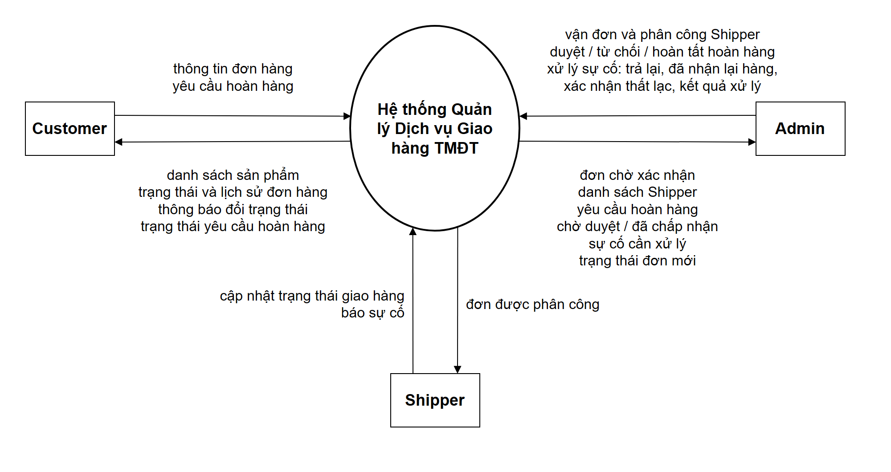

# 2 Mô tả tổng quan

## 2.1 Bối cảnh sản phẩm

Ứng dụng Quản lý Dịch vụ Giao hàng Thương mại điện tử là một hệ thống phần mềm mới. Hệ thống là web riêng của một cửa hàng, không phải sàn có nhiều người bán (xem AS-1). Ba lớp người dùng làm việc với hệ thống: Customer, Admin và Shipper (xem 2.2). Sơ đồ ngữ cảnh ở Hình 1 thể hiện các lớp người dùng và dữ liệu trao đổi giữa từng lớp với hệ thống. Phiên bản này không kết nối với hệ thống bên ngoài nào (xem 5.2, C-2).

## 2.2 Các lớp người dùng

| Lớp người dùng | Mô tả |
|---|---|
| Customer | Customer là người mua của cửa hàng, tương tự người mua trên Shopee. Customer tạo đơn hàng, theo dõi đơn hàng và yêu cầu hoàn hàng. Customer tự đăng ký tài khoản (xem AS-2). Số lượng: chưa có số liệu (xem AS-1). |
| Admin | Admin là nhân viên cửa hàng, gộp vai trò của người bán và sàn trên Shopee. Admin tạo vận đơn và phân công Shipper; duyệt hoặc từ chối yêu cầu hoàn hàng; xử lý sự cố. Có thể có nhiều tài khoản Admin, tất cả thuộc cùng một cửa hàng. Tài khoản Admin đã có sẵn (xem AS-2). Số lượng: chưa có số liệu. |
| Shipper | Shipper là nhân viên giao hàng, tương tự nhân viên SPX Express. Shipper lấy hàng, giao hàng, cập nhật trạng thái và báo sự cố. Tài khoản Shipper đã có sẵn (xem AS-2). Số lượng: chưa có số liệu (xem AS-1). |

## 2.3 Môi trường hoạt động

- **OE-1:** Hệ thống phải là một ứng dụng web mà người dùng truy cập qua trình duyệt.
- **OE-2:** Hệ thống phải hoạt động đúng trên các trình duyệt sau: TBD (xem C-8).

## 2.4 Ràng buộc thiết kế và cài đặt

- **CO-1:** Hệ thống phải cập nhật trạng thái theo sự kiện, không dùng cơ chế tự tải lại theo chu kỳ (xem RT-1, RT-2).

Ngôn ngữ giao diện: TBD (xem C-9).

## 2.5 Giả định và phụ thuộc

- **AS-1:** Hệ thống phục vụ một cửa hàng; mọi sản phẩm và đơn hàng thuộc cửa hàng đó. Customer và Shipper không giới hạn số lượng. Admin có thể có nhiều tài khoản, tất cả là nhân viên của cùng cửa hàng.
- **AS-2:** Tài khoản Admin và Shipper đã có sẵn; Customer tự đăng ký tài khoản.
- **AS-3:** Danh sách sản phẩm có sẵn dưới dạng dữ liệu mẫu.
- **AS-4:** Thanh toán nằm ngoài hệ thống (xem BR-07).

Chưa xác định phụ thuộc bên ngoài nào ở phiên bản này (xem C-2).
