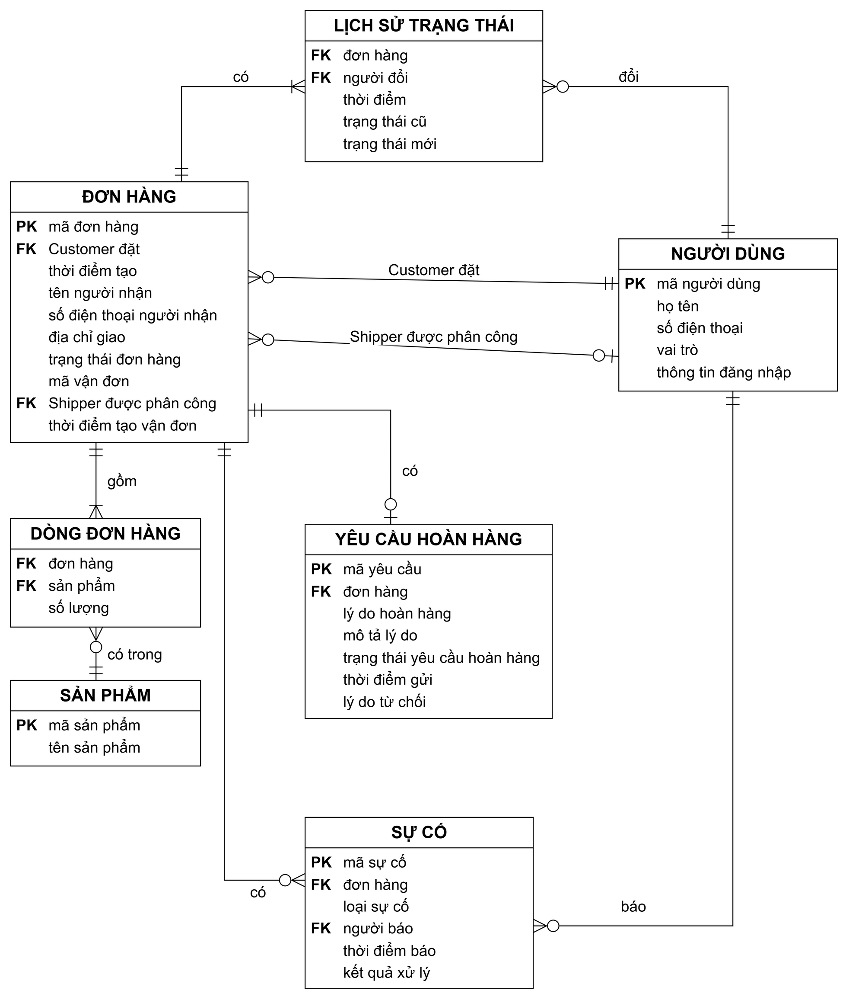

# 4 Yêu cầu dữ liệu

## 4.1 Mô hình dữ liệu logic

Hình 2 thể hiện các thực thể dữ liệu của hệ thống và quan hệ giữa chúng. Mô hình không có thực thể Cửa hàng vì hệ thống chỉ phục vụ một cửa hàng (xem AS-1).

Một đơn hàng có một hoặc nhiều dòng đơn hàng (xem Order.Create.Product) và có tối đa một yêu cầu hoàn hàng (xem Return.Request.Eligible).

## 4.2 Từ điển dữ liệu

| Phần tử dữ liệu | Mô tả | Kiểu hoặc thành phần | Độ dài | Giá trị |
|---|---|---|---|---|
| Customer đặt | Customer đã tạo đơn hàng | mã người dùng | | Người dùng có vai trò Customer |
| dòng đơn hàng | một sản phẩm trong đơn hàng, kèm số lượng đặt | sản phẩm + số lượng | | |
| địa chỉ giao | nơi giao đơn hàng cho người nhận | chuỗi | 255 | Bắt buộc. Chuỗi tự do, không được rỗng sau khi bỏ khoảng trắng hai đầu (xem Order.Create.Address) |
| đơn hàng | thông tin về một đơn hàng do Customer tạo | mã đơn hàng + Customer đặt + thời điểm tạo + 1:m{dòng đơn hàng} + người nhận + địa chỉ giao + trạng thái đơn hàng + 0:1{vận đơn} | | Có ít nhất một dòng đơn hàng; không có hai dòng cùng một sản phẩm (xem Order.Create.Product) |
| email | địa chỉ email người dùng dùng để đăng nhập | chuỗi | 254 | Duy nhất (xem Account.Register.Unique). Bắt buộc khi Customer đăng ký; định dạng theo Account.Register.Email; tối đa 254 ký tự (tham khảo S12); so khớp không phân biệt chữ hoa, chữ thường. |
| họ tên | họ tên của người dùng | chuỗi | 100 | |
| kết quả xử lý | kết quả Admin ghi cho một sự cố | chuỗi, do Admin nhập | 500 | Bắt buộc, không được rỗng sau khi bỏ khoảng trắng hai đầu. Chỉ ghi nhận, không xử lý tiền (xem BR-07) |
| lịch sử trạng thái | bản ghi một lần thay đổi trạng thái của đơn hàng | đơn hàng + người đổi + thời điểm + trạng thái cũ + trạng thái mới | | Chỉ được thêm (xem DI-1). Bản ghi đầu tiên: trạng thái cũ để trống |
| loại sự cố | loại sự cố được báo cho một đơn hàng | chuỗi | Không áp dụng | "Hàng hỏng", "Giao không thành công", "Thất lạc" |
| lý do hoàn hàng | lý do Customer chọn khi gửi yêu cầu hoàn hàng | chuỗi | Không áp dụng | Một trong các lý do ở BR-04 |
| lý do từ chối | lý do Admin ghi khi từ chối một yêu cầu hoàn hàng | chuỗi | 500 | Bắt buộc khi yêu cầu bị từ chối; không được rỗng sau khi bỏ khoảng trắng hai đầu (xem Return.Review.Reject) |
| mã đơn hàng | mã hệ thống gán cho mỗi đơn hàng khi lưu đơn | chuỗi | Không áp dụng | Duy nhất |
| mã người dùng | mã hệ thống gán cho mỗi người dùng | chuỗi | Không áp dụng | Duy nhất |
| mã sản phẩm | mã của một sản phẩm trong dữ liệu mẫu | chuỗi | Không áp dụng | Duy nhất |
| mã sự cố | mã hệ thống gán cho mỗi sự cố | chuỗi | Không áp dụng | Duy nhất |
| mã vận đơn | mã hệ thống gán cho mỗi vận đơn | chuỗi | Không áp dụng | Duy nhất (xem Track.Assign.Shipment) |
| mã yêu cầu | mã hệ thống gán cho mỗi yêu cầu hoàn hàng | chuỗi | Không áp dụng | Duy nhất |
| mật khẩu | mật khẩu người dùng dùng để đăng nhập | chuỗi | 64 | Bắt buộc khi Customer đăng ký; lưu theo SEC-10. Tối thiểu 8 ký tự; cho phép mọi ký tự, không bắt buộc chữ hoa, số hay ký tự đặc biệt (xem Account.Register.Password; quyết định nhóm 10/11/2026, tham khảo S10) |
| mô tả lý do | mô tả Customer nhập khi chọn lý do hoàn hàng "Khác" | chuỗi | 500 | Bắt buộc khi lý do hoàn hàng là "Khác"; không được rỗng sau khi bỏ khoảng trắng hai đầu (xem Return.Request.Reason) |
| người báo | người dùng đã báo một sự cố | mã người dùng | | Shipper được phân công cho đơn hàng, hoặc Admin (xem Issue.Resolve.Lost) |
| người dùng | người có tài khoản trong hệ thống | mã người dùng + họ tên + số điện thoại + vai trò + thông tin đăng nhập | | Customer đăng ký bằng họ tên, số điện thoại, email và mật khẩu (xem AS-2) |
| người đổi | người dùng đã làm trạng thái đơn hàng thay đổi | mã người dùng | | |
| người nhận | người nhận hàng của đơn hàng | tên người nhận + số điện thoại người nhận | | Cả hai thành phần bắt buộc (xem Order.Create.Required) |
| sản phẩm | sản phẩm của cửa hàng mà Customer chọn khi tạo đơn hàng | mã sản phẩm + tên sản phẩm | | Dữ liệu mẫu (xem AS-3) |
| Shipper được phân công | Shipper được Admin phân công giao đơn hàng | mã người dùng | | Người dùng có vai trò Shipper |
| số điện thoại | số điện thoại của người dùng | chuỗi | 10 | Bắt buộc khi Customer đăng ký. Cùng quy tắc với số điện thoại người nhận (xem Account.Register.Phone) |
| số điện thoại người nhận | số điện thoại của người nhận hàng | chuỗi | 10 | Bắt buộc. Đúng 10 chữ số, bắt đầu bằng chữ số 0, tức số thuê bao di động (xem Order.Create.Phone, tham khảo S8) |
| số lần giao không thành công | dùng để quyết định giao lại hay trả lại một đơn hàng | số nguyên, tính ra, không lưu | Không áp dụng | Tính theo BR-06 |
| số lượng | số đơn vị của một sản phẩm trong một dòng đơn hàng | số nguyên | Không áp dụng | Số nguyên lớn hơn hoặc bằng 1, không có giới hạn trên (xem Order.Create.Quantity) |
| sự cố | sự cố khi giao hàng được báo cho một đơn hàng | mã sự cố + đơn hàng + loại sự cố + người báo + thời điểm báo + kết quả xử lý | | |
| tên người nhận | tên của người nhận hàng | chuỗi | 100 | Bắt buộc, không được rỗng sau khi bỏ khoảng trắng hai đầu (xem Order.Create.Required) |
| tên sản phẩm | tên của một sản phẩm | chuỗi | Không áp dụng | Dữ liệu mẫu (xem AS-3) |
| thời điểm | ngày giờ trạng thái đơn hàng thay đổi, trong một bản ghi lịch sử trạng thái | ngày giờ, hiển thị dạng dd/MM/yyyy HH:mm theo giờ Việt Nam (UTC+7) | 16 | |
| thời điểm báo | ngày giờ một sự cố được báo | ngày giờ, hiển thị dạng dd/MM/yyyy HH:mm theo giờ Việt Nam (UTC+7) | 16 | |
| thời điểm gửi | ngày giờ Customer gửi yêu cầu hoàn hàng | ngày giờ, hiển thị dạng dd/MM/yyyy HH:mm theo giờ Việt Nam (UTC+7) | 16 | |
| thời điểm tạo | ngày giờ đơn hàng được lưu | ngày giờ, hiển thị dạng dd/MM/yyyy HH:mm theo giờ Việt Nam (UTC+7) | 16 | |
| thời điểm tạo vận đơn | ngày giờ Admin tạo vận đơn | ngày giờ, hiển thị dạng dd/MM/yyyy HH:mm theo giờ Việt Nam (UTC+7) | 16 | |
| thông tin đăng nhập | thông tin người dùng dùng để đăng nhập | email + mật khẩu | | Mỗi email chỉ thuộc một tài khoản |
| trạng thái cũ | trạng thái đơn hàng trước một lần thay đổi | trạng thái đơn hàng | | Để trống ở bản ghi lịch sử đầu tiên |
| trạng thái đơn hàng | trạng thái hiện tại của một đơn hàng | chuỗi | Không áp dụng | "Chờ xác nhận", "Chờ lấy hàng", "Đang giao", "Đã giao", "Giao không thành công", "Đang hoàn hàng", "Đã hoàn về người bán", "Hư hỏng", "Thất lạc" (xem Hình A.2) |
| trạng thái mới | trạng thái đơn hàng sau một lần thay đổi | trạng thái đơn hàng | | |
| trạng thái yêu cầu hoàn hàng | trạng thái hiện tại của một yêu cầu hoàn hàng | chuỗi | Không áp dụng | "Chờ duyệt", "Đã chấp nhận", "Bị từ chối", "Hoàn tất" (xem Hình A.2) |
| vai trò | vai trò của người dùng, quyết định thao tác được phép (xem mục 6.2) | chuỗi | Không áp dụng | Customer, Shipper, Admin |
| vận đơn | thông tin Admin tạo cho một đơn hàng khi phân công Shipper | mã vận đơn + Shipper được phân công + thời điểm tạo vận đơn | | |
| yêu cầu hoàn hàng | yêu cầu Customer gửi để hoàn hàng cho một đơn hàng đã giao | mã yêu cầu + đơn hàng + lý do hoàn hàng + mô tả lý do + trạng thái yêu cầu hoàn hàng + thời điểm gửi + lý do từ chối | | Mỗi đơn hàng có tối đa một yêu cầu hoàn hàng (xem Return.Request.Eligible) |

## 4.3 Báo cáo

Không thuộc phiên bản này. Đề bài không yêu cầu báo cáo thống kê nên báo cáo nằm ngoài phạm vi (xem mục 1.3).

## 4.4 Toàn vẹn, lưu giữ và hủy dữ liệu

- **DI-1:** Hệ thống phải chỉ cho phép thêm bản ghi lịch sử trạng thái, không cho phép sửa hay xóa bản ghi đã có.

Việc ghi lịch sử mỗi khi trạng thái đơn hàng thay đổi là yêu cầu Track.Update.History ở mục 3.2, mục này không viết lại.

Thời hạn lưu dữ liệu: xem AS-5.
